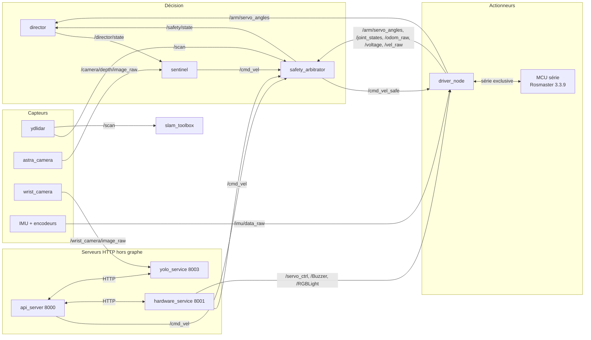
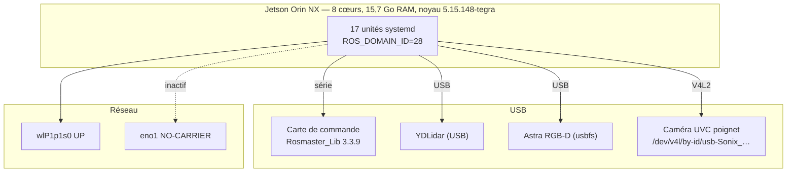
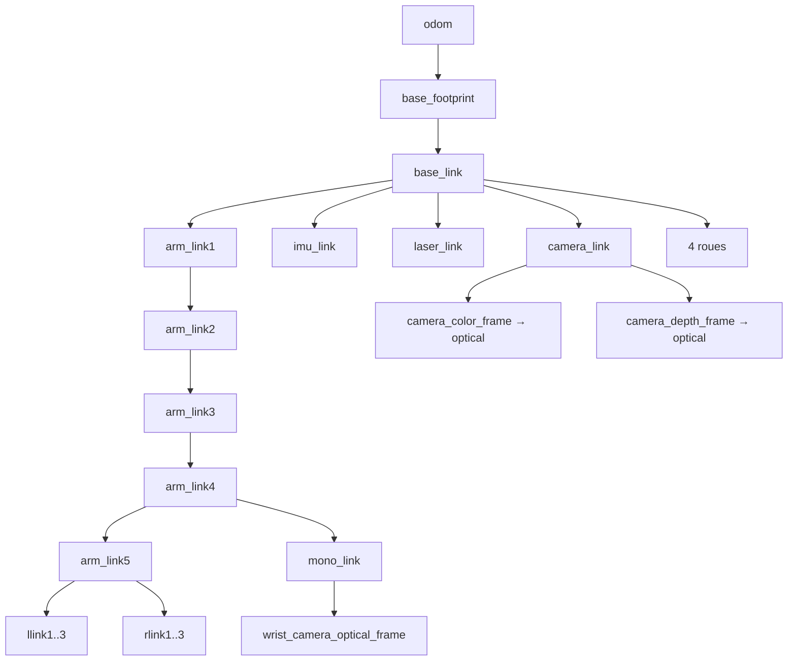

# Architecture factuelle — Clawbot X3 (ROS 2 Humble, domaine 28)

## 1. Périmètre et méthode

- Système observé : robot Clawbot X3 en fonctionnement nominal, 20 nœuds actifs, domaine DDS 28, le 2026-11-22 entre 10:59 et 11:08 (CET). Contexte complet : [S20], [S35].
- Workspace : `/home/jetson/clawbot`, 38 paquets à la racine (aucun répertoire `src/`), branche `docs/site-okf-merge` [S21], [S35].
- Trois paquets déployés proviennent du workspace vendor `/home/jetson/yahboomcar_ros2_ws` et non du dépôt : `astra_camera`, `ydlidar_ros2_driver`, `robot_localization` (chemins complets dans les lignes `ExecStart` de [S25]).
- Exclu : paquets vendor non déployés, LLM distant, mécanique du bras.
- Collecte en lecture seule : `ros2 node|topic|service|param list|info`, `ros2 topic hz|echo`, `systemctl show|list-units|--failed`, `journalctl`, `ps`, `df`, `ss`, `tegrastats`, `cat`. Aucune unité arrêtée ni redémarrée, aucune publication, aucun paramètre écrit.

Le système se lit en deux couches : une **couche ROS 2** (20 nœuds, 54 topics, 0 action, 0 composition) et une **couche d'intégration HTTP** hors graphe (trois serveurs : 8000 API, 8001 matériel, 8003 YOLO) qui porte une partie de la logique de décision et n'apparaît ni dans le graphe ni dans ses QoS.

## 2. Cible matérielle et logicielle

| Élément | Valeur mesurée | Source |
|---|---|---|
| Carte | Jetson Orin NX, noyau `5.15.148-tegra` | [S20] |
| Distribution ROS 2 | `humble` | [S17] |
| Middleware (RMW) | `rmw_fastrtps_cpp` | [S17] |
| Profil Fast DDS chargé | aucun : `FASTRTPS_DEFAULT_PROFILES_FILE` non défini | [S20] |
| Variable CycloneDDS | non définie | [S20] |
| Domaine DDS | 28 (imposé par chaque unité) | [S25] |
| Interfaces réseau actives | `wlP1p1s0` UP (état DORMANT) ; `eno1` NO-CARRIER ; `l4tbr0`, `usb0`, `usb1` DOWN ; `can0` DOWN | [S15] |
| Sockets RTPS | 6 sockets UDP en écoute sur `0.0.0.0` (7400, 7412, 7413, 7414, 7415) | [S14] |
| RAM | 7 092 / 15 656 Mo utilisés | [S16] |
| Mémoire partagée | `/dev/shm` : 12 Mo utilisés sur 7,7 Go (1 %) | [S13] |
| Disque | 117 Go utilisés sur 147 Go (84 %) | [S13] |
| Uptime / charge | 6 j 22 h ; load average 2,98 (1 min) | [S20] |
| Fréquence CPU observée | 729 MHz ou 1 190 MHz selon les cœurs, 8 cœurs | [S16] |
| Accélérateur | `GR3D_FREQ 0 %` sur toute la fenêtre de 6 s | [S16] |
| Températures | `cpu 53,5 °C`, `tj 53,5 °C`, `gpu 50,9 °C`, `soc0 48,3 °C` | [S16] |
| Puissance | `VDD_IN 6 090 mW` | [S16] |

Faits qui en découlent et qui contraignent toute refonte :

1. **Aucun transport partagé n'est configuré** : sans `FASTRTPS_DEFAULT_PROFILES_FILE`, Fast DDS utilise ses transports par défaut, et le taux d'occupation de `/dev/shm` (1 %) montre qu'aucun segment de mémoire partagée significatif n'est en usage [S13], [S20]. Le profil `fastdds_profile.xml` du dépôt ([S40]) déclare un participant UDP-only : il n'est pas chargé.
2. **Le trafic DDS circule sur le Wi-Fi** : la seule interface montée est `wlP1p1s0`, `eno1` est sans porteuse [S15].
3. **Le GPU est inutilisé** (`GR3D_FREQ 0 %`), alors que le service YOLO tourne et consomme 1,5 Go de RSS [S12], [S16].
4. **Le disque est à 84 %**, ce qui interdit d'installer sans nettoyage préalable [S13].

## 3. Packages

38 paquets `package.xml` sur disque [S21]. Origine : `maison` = écrit pour ce robot ; `vendor` = copie Yahboom ; `démo` = paquets d'exercice sans usage en production.

| Paquet | Version | Langage | Origine | Rôle observé | Source |
|---|---|---|---|---|---|
| `clawbot_arm_controller` | 0.1.0 | py | maison | serveur de trajectoire du bras | [S21] |
| `clawbot_director` | 0.1.0 | py | maison | décision S1, service `/director/command` | [S21], [S04] |
| `clawbot_hardware_interface` | 0.0.0 | py+cpp | maison | plugin `ros2_control` | [S21] |
| `clawbot_interfaces` | 0.1.0 | interfaces | maison | `DirectorCommand.srv` | [S21], [S22] |
| `clawbot_moveit_config` | 0.1.0 | py | maison | configuration MoveIt 2 et outils | [S21] |
| `clawbot_safety` | 0.1.0 | py | maison | arbitrage `/cmd_vel` → `/cmd_vel_safe` | [S21], [S02] |
| `clawbot_sentinel` | 0.1.0 | py | maison | surveillance, mots d'arrêt | [S21], [S02] |
| `ros2_llm_bridge` | 0.0.0 | py | maison | pont HTTP 8000/8001 + nœud `llm_bridge_node` | [S21], [S02] |
| `ros2_llm_bridge_cpp` | 2.0.0 | py+cpp | maison | serveur API C++ (port 8000) | [S21], [S25] |
| `bridge_mcp` | — | py | maison | pont MCP (hors graphe, pas de `package.xml`) | [S21] |
| `yolo_node` | — | py | maison | service YOLO HTTP 8003 (`yolo_service.py`) | [S21], [S12] |
| `yahboomcar_bringup` | 0.0.0 | py | vendor | pilote châssis `Mcnamu_driver_X3` | [S21], [S02] |
| `yahboomcar_astra` | 0.0.0 | py | vendor | lancement caméra Astra | [S21] |
| `yahboomcar_base_node` | 0.0.0 | cpp | vendor | nœud de base | [S21] |
| `yahboomcar_ctrl` | 0.0.0 | py | vendor | téléopération clavier | [S21] |
| `yahboomcar_description` | 0.0.0 | py | vendor | URDF/xacro du châssis | [S21], [S27] |
| `yahboomcar_laser` | 0.0.0 | py | vendor | évitement et suivi laser | [S21] |
| `yahboomcar_msgs` | 0.0.0 | interfaces | vendor | 5 messages maison | [S21], [S22] |
| `yahboomcar_nav` | 0.0.0 | py | vendor | lancement navigation | [S21] |
| `yahboomcar_slam` | 0.0.0 | py+cpp | vendor | cartographie alternative | [S21] |
| `yahboomcar_visual`, `yahboomcar_point`, `yahboomcar_multi`, `yahboomcar_rviz`, `yahboomcar_voice_ctrl`, `yahboomcar_mediapipe`, `yahboomcar_KCFTracker`, `yahboomcar_linefollow`, `yahboom_app_save_map`, `robot_pose_publisher_ros2`, `laserscan_to_point_pulisher`, `yahboom_web_savmap_interfaces` | 0.0.0 | py/cpp | vendor | démonstrations et outils, aucun processus actif | [S21] |
| `pkg_action`, `pkg_helloworld_py`, `pkg_interfaces`, `pkg_metapackage`, `pkg_param`, `pkg_service`, `pkg_tf`, `pkg_topic` | 0.0.0 | py | démo | exercices de didacticiel | [S21] |

Deux constats de structure :

- **Le paquet `bridge_mcp` (25 outils MCP) n'a pas de `package.xml`** : il n'appartient pas au workspace colcon, il est lancé par le client MCP [S21].
- **Le pilote châssis existe en deux copies identiques** : `clawbot/yahboomcar_bringup/yahboomcar_bringup/Mcnamu_driver_X3.py` et `yahboomcar_ros2_ws/yahboomcar_ws/src/yahboomcar_bringup/yahboomcar_bringup/Mcnamu_driver_X3.py` (`diff -q` sans écart au 2026-11-22T11:10). Le déploiement lit la seconde [S25].

## 4. Nœuds actifs

20 nœuds [S01]. Les deux entrées `transform_listener_impl_*` et `launch_ros_1308` ne sont pas des nœuds applicatifs : ce sont des artefacts internes (écouteurs TF et moniteur de `ros2 launch`).

| Nœud | Paquet / processus | Unité systemd | Pub | Sub | Source |
|---|---|---|---|---|---|
| `/director` | `clawbot_director` (py) | `clawbot-director.service` | 3 | 2 | [S02], [S25] |
| `/safety_arbitrator` | `clawbot_safety` (py) | `clawbot-safety-arbitrator.service` | 5 | 5 | [S02], [S25] |
| `/sentinel` | `clawbot_sentinel` (py) | `clawbot-sentinel.service` | 5 | 3 | [S02], [S25] |
| `/driver_node` | `yahboomcar_bringup` (py, `Rosmaster(car_type=2)`) | `ros2-driver-node.service` | 10 | 4 | [S02], [S25] |
| `/hardware_service_node` | `ros2_llm_bridge/hardware_service.py` | `ros2-hardware-service.service` | 6 | 6 | [S02], [S25] |
| `/llm_bridge_node` | `ros2_llm_bridge_cpp` | `ros2-llm-bridge-cpp.service` | 3 | 1 | [S02], [S25] |
| `/camera/camera` | `astra_camera` (vendor, C++) | aucune unité dédiée (lancé par le service matériel) | 11 | 3 | [S02], [S12] |
| `/wrist_camera/camera` | `v4l2_camera` | `clawbot-wrist-camera.service` | 7 | 1 | [S02], [S25] |
| `/yolo_source_camera` | `yolo_service.py` | `yolo-inference.service` | 0 | 1 | [S02], [S25] |
| `/ydlidar_ros2_driver_node` | `ydlidar_ros2_driver` (vendor, C++) | `clawbot-lidar.service` | 4 | 1 | [S02], [S25] |
| `/ekf_filter_node` | `robot_localization` (vendor, C++) | `clawbot-ekf.service` | 5 | 4 | [S02], [S25], [S39] |
| `/slam_toolbox` | `slam_toolbox` (asynchrone, mode `mapping`) | `clawbot-slam.service` | 9 | 4 | [S02], [S25] |
| `/robot_state_publisher` | `robot_state_publisher` | `clawbot-description.service` | 5 | 2 | |
| `/joint_state_publisher` | `joint_state_publisher` | lancé par `clawbot-description.service` | 3 | 2 | [S02], [S12] |
| `/rosbridge_websocket`, `/rosapi`, `/rosapi_params` | `rosbridge_server` | aucune unité dédiée | 4 / 2 / 2 | 0 | [S02], [S12] |

Nœuds **absents** du graphe alors que leurs unités ou leurs paquets existent : `clawbot-arm-controller` (aucun nœud `/arm_trajectory_server`), `clawbot-move-group` (aucun `move_group`, donc **aucune action** — cf. §6), `clawbot-nav2`, `clawbot-joy-teleop`, `clawbot-health` [S01], [S25]. Ces unités ne figurent pas dans la liste des services en cours d'exécution [S25].

## 5. Topics

54 topics, 8 avec zéro éditeur, 12 avec zéro abonné [S07]. Cadence mesurée sur 39 topics (images et nuages exclus de la boucle) [S08], puis sur les flux capteurs [S09].

| Topic | Type | Éd. | Ab. | Cadence mesurée | Source |
|---|---|---|---|---|---|
| `/scan` | `sensor_msgs/msg/LaserScan` | 1 | 2 | 10,125 Hz (min 0,095 s / max 0,102 s) | [S09] |
| `/point_cloud` | `sensor_msgs/msg/PointCloud` | 1 | 0 | 10,110 Hz | [S09] |
| `/camera/color/image_raw` | `sensor_msgs/msg/Image` | 1 | 0 | 30,004 Hz | [S09] |
| `/camera/depth/image_raw` | `sensor_msgs/msg/Image` | 1 | 2 | **0 message en 12 s** | [S09] |
| `/camera/depth/points` | `sensor_msgs/msg/PointCloud2` | 1 | 0 | **0 message en 12 s** | [S09] |
| `/wrist_camera/image_raw` | `sensor_msgs/msg/Image` | 1 | 1 | 30 Hz (std dev 2,09 ms) | [S09] |
| `/camera/color/camera_info` | `sensor_msgs/msg/CameraInfo` | 1 | 0 | non mesuré (exclu de la boucle) | [S03] |
| `/camera/depth/camera_info`, `/camera/ir/camera_info`, `/camera/ir/image_raw` | `CameraInfo`, `Image` | 1 | 0-1 | non mesuré | [S03] |
| `/camera/detection_image` | `sensor_msgs/msg/CompressedImage` | **0** | 1 | aucun éditeur | [S07] |
| `/detections` | `std_msgs/msg/String` | **0** | 1 | aucun éditeur | [S07] |
| `/sentinel/transcript` | `std_msgs/msg/String` | **0** | 1 | aucun éditeur | [S07] |
| `/arm/joint_states` | `sensor_msgs/msg/JointState` | **0** | 1 | aucun éditeur | [S07] |
| `/set_pose` | `geometry_msgs/msg/PoseWithCovarianceStamped` | **0** | 1 | aucun éditeur | [S07] |
| `/slam_toolbox/feedback` | `visualization_msgs/msg/InteractiveMarkerFeedback` | **0** | 1 | aucun éditeur | [S07] |
| `/ydlidar_ros2_driver_node/transition_event` | `lifecycle_msgs/msg/TransitionEvent` | **0** | 1 | attendu (moniteur de lancement) | [S07] |
| `/voltage` | `std_msgs/msg/Float32` | 1 | 2 | 10,015 Hz | [S08] |
| `/edition` | `std_msgs/msg/Float32` | 1 | 0 | 9,986 Hz | [S08] |
| `/imu/data_raw` | `sensor_msgs/msg/Imu` | 1 | 3 | 10,019 Hz | [S08] |
| `/imu/mag` | `sensor_msgs/msg/MagneticField` | 1 | 0 | 9,999 Hz | [S08] |
| `/odom_raw` | `nav_msgs/msg/Odometry` | 1 | 1 | 9,998 Hz | [S08] |
| `/odom` | `nav_msgs/msg/Odometry` | 1 | 0 | 10,001 Hz | [S08] |
| `/vel_raw` | `geometry_msgs/msg/Twist` | 1 | 1 | 10,047 Hz | [S08] |
| `/joint_states` | `sensor_msgs/msg/JointState` | 2 | 1 | 20,000 Hz | [S08] |
| `/arm/servo_angles` | `std_msgs/msg/Int32MultiArray` | 1 | 2 | 10,016 Hz | [S08] |
| `/cmd_vel` | `geometry_msgs/msg/Twist` | 3 | 1 | **0 message en 7 s** (robot à l'arrêt) | [S08] |
| `/cmd_vel_safe` | `geometry_msgs/msg/Twist` | 1 | 1 | 20,001 Hz | [S08] |
| `/safety/hold`, `/safety/state` | `std_msgs/msg/Bool`, `String` | 1 | 0-1 | 20,000 Hz | [S08] |
| `/director/state` | `std_msgs/msg/String` | 1 | 1 | 4,999 Hz | [S08] |
| `/sentinel/state` | `std_msgs/msg/String` | 1 | 0 | 2,000 Hz | [S08] |
| `/sentinel/event` | `std_msgs/msg/String` | 1 | 0 | 0 message en 7 s | [S08] |
| `/diagnostics` | `diagnostic_msgs/msg/DiagnosticArray` | 1 | 0 | 1,936 Hz | [S08] |
| `/tf` | `tf2_msgs/msg/TFMessage` | 5 | 2 | 25,959 Hz | [S08] |
| `/tf_static` | `tf2_msgs/msg/TFMessage` | 2 | 2 | aucun message (QoS TRANSIENT_LOCAL, publié à l'attachement) | [S08], [S07] |
| `/map`, `/map_metadata` | `nav_msgs/msg/OccupancyGrid`, `MapMetaData` | 1 | 2 / 0 | 0 message en 12 s (publication sur mise à jour) | [S09] |
| `/robot_description` | `std_msgs/msg/String` | 1 | 1 | aucun message (TRANSIENT_LOCAL) | [S08] |
| `/pose` | `PoseWithCovarianceStamped` | 1 | 0 | non publié pendant la fenêtre | [S08] |
| `/Buzzer`, `/RGBLight`, `/servo_ctrl` | `Bool`, `Int32`, `Int32MultiArray` | 1 | 1 | 0 message en 7 s | [S08] |
| `/slam_toolbox/graph_visualization`, `/scan_visualization`, `/update` | `MarkerArray`, `LaserScan`, `InteractiveMarkerUpdate` | 1 | 0 | pas de message | [S08] |
| `/client_count`, `/connected_clients` | `Int32`, `ConnectedClients` | 1 | 0 | aucun message (TRANSIENT_LOCAL) | [S07] |
| `/wrist_camera/image_raw/compressed`, `/compressedDepth`, `/theora` | `CompressedImage`, `Packet` | 1 | 0 | non mesuré | [S03] |
| `/wrist_camera/camera_info` | `CameraInfo` | 1 | 0 | non mesuré | [S03] |

Deux ruptures de chaîne établies par ces mesures :

1. **La chaîne de profondeur est morte.** `astra_camera` publie `/camera/depth/image_raw` et `/camera/depth/points` (1 éditeur chacun) mais **aucun message n'arrive en 12 s**, alors que le même processus publie la couleur à 30 Hz et consomme 57,2 % de CPU [S09], [S12]. Le nœud `/sentinel` est abonné à `/camera/depth/image_raw` : il reçoit donc zéro message.
2. **La chaîne de détection est morte.** `/detections` et `/camera/detection_image` n'ont aucun éditeur ; `/yolo_source_camera` a 0 éditeur et 1 abonnement [S07]. Le service YOLO tourne pourtant en HTTP (port 8003) avec 1,5 Go de RSS [S12], [S25].

## 6. Services et actions

**Actions : aucune.** `ros2 action list -t` ne renvoie rien (artefact vide, cf. [S05]) alors que `clawbot_arm_controller` et `clawbot_moveit_config` déclarent des serveurs d'action dans leur code [S30] : leurs unités ne tournent pas [S25].

| Service | Type | Serveur | Clients observés | Source |
|---|---|---|---|---|
| `/director/command` | `clawbot_interfaces/srv/DirectorCommand` | `director` | hors graphe (HTTP 8000 / MCP) | [S04], [S38] |
| `/set_pose` | `robot_localization/srv/SetPose` | `ekf_filter_node` | aucun | [S04] |
| `/toggle` | `robot_localization/srv/ToggleFilterProcessing` | `ekf_filter_node` | aucun | [S04] |
| `/enable` | `std_srvs/srv/Empty` | `slam_toolbox` | aucun | [S04] |
| `/start_scan`, `/stop_scan` | `std_srvs/srv/Empty` | `ydlidar_ros2_driver_node` | aucun | [S04] |
| `/slam_toolbox/{save_map,serialize_map,deserialize_map,dynamic_map,clear_changes,manual_loop_closure,pause_new_measurements,toggle_interactive_mode,get_interactive_markers}` | types `slam_toolbox/*`, `nav_msgs/srv/GetMap` | `slam_toolbox` | aucun | [S04] |
| `/camera/{get_camera_info,get_device_info,set_depth_exposure,set_laser_enable,…}` (43 services) | `astra_camera_msgs/*`, `std_srvs/*` | `camera` | aucun | [S04] |
| `/wrist_camera/set_camera_info` | `sensor_msgs/srv/SetCameraInfo` | `wrist_camera/camera` | aucun | [S04] |
| `/ydlidar_ros2_driver_node/change_state` | `lifecycle_msgs/srv/ChangeState` | `ydlidar_ros2_driver_node` | `launch_ros_1308` | [S04], [S02] |
| `/<nœud>/{describe,get,set,list}_parameters{, _atomically}` | `rcl_interfaces/*` | les 13 nœuds ROS 2 | `rosapi` | [S04], [S02] |

`DirectorCommand` est un service **à charge utile JSON opaque** : `string request_json` en entrée, `string response_json` en sortie [S38]. Aucune validation de schéma n'est exprimée dans l'interface : le contrat réel est dans le code du directeur et dans la documentation du pont.

Interfaces maison (10 fichiers) [S22] : `clawbot_interfaces/srv/DirectorCommand.srv`, `yahboomcar_msgs/msg/{ImageMsg,PointArray,Position,TargetArray,Target}.msg`, `yahboom_web_savmap_interfaces/src/srv/WebSaveMap.srv`, et trois paquets de démonstration (`pkg_interfaces/{action/Progress.action,msg/Person.msg,srv/Add.srv}`). Les 5 messages `yahboomcar_msgs` n'ont **aucun éditeur ni abonné** dans le graphe [S03], [S07].

## 7. TF2

Arêtes statiques (6) relevées sur `/tf_static` [S10] :

| Parent | Enfant |
|---|---|
| `base_footprint` | `base_link` |
| `base_link` | `camera_link` |
| `base_link` | `imu_link` |
| `base_link` | `laser_link` |
| `arm_link4` | `mono_link` |
| `mono_link` | `wrist_camera_optical_frame` |

Arêtes dynamiques supplémentaires observées sur 5 s de `/tf` [S11] : `odom → base_footprint`, `base_link → arm_link1 → arm_link2 → arm_link3 → arm_link4 → arm_link5`, `arm_link5 → llink1 → llink2 → llink3`, `arm_link5 → rlink1 → rlink2 → rlink3`, `base_link → {front_left_wheel, front_right_wheel, back_left_wheel, back_right_wheel}`, `camera_link → camera_color_frame → camera_color_optical_frame`, `camera_link → camera_depth_frame → camera_depth_optical_frame`.

- **Une seule racine** : `odom`, alimentée par l'EKF [S11], [S39].
- **Un seul écrivain de `odom → base_footprint`** : `ekf_filter_node` (diffuseur TF déclaré, 5 Hz de sortie) [S32], [S02].
- **`arm_link4 → mono_link` est statique** alors que `base_link → arm_link4` est dynamique : la chaîne du bras n'est complète que si `joint_state_publisher` et `robot_state_publisher` publient les joints du bras. Or `/arm/joint_states` n'a **aucun éditeur** [S07] : la chaîne `arm_link1..4` observée provient donc d'un autre chemin, que la collecte n'isole pas. `[NON OBSERVÉ / À VÉRIFIER]` → obtenir : `ros2 run tf2_tools view_frames` puis `ros2 topic echo /joint_states --once` pour attribuer chaque arête à son éditeur.
- **`wrist_camera_optical_frame` est un enfant de `mono_link`** (statique) et non de `arm_link5` : la caméra du poignet est donc rattachée à la chaîne du bras par un joint fixe intermédiaire, conformément à l'URDF [S27], [S10].

## 8. Paramètres

| Nœud | Paramètres déclarés au runtime | Constat | Source |
|---|---|---|---|
| `/director` | 1 (`use_sim_time`) | toute la configuration vient de fichiers YAML lus au démarrage, pas de paramètres ROS | [S06] |
| `/safety_arbitrator` | 1 (`use_sim_time`) | idem | [S06] |
| `/sentinel` | 1 (`use_sim_time`) | idem | [S06] |
| `/hardware_service_node` | 1 (`use_sim_time`) | idem | [S06] |
| `/yolo_source_camera` | 1 (`use_sim_time`) | idem | [S06] |
| `/driver_node` | 7 (`Prefix`, `angular_limit`, `car_type`, `imu_link`, `xlinear_limit`, `ylinear_limit`, `use_sim_time`) | limites cinématiques exposées, port série **non exposé** | [S06] |
| `/ekf_filter_node` | 63 (`frequency`, `imu0*`, `odom0*`, `base_link_frame`, `control_timeout`, …) | configuration entièrement paramétrique | [S06], [S39] |
| `/slam_toolbox` | 70 (`base_frame`, `odom_frame`, `map_update_interval`, …) | configuration entièrement paramétrique | [S06] |
| `/ydlidar_ros2_driver_node` | 27 (`port`, `baudrate`, `frame_id`, `frequency`, `angle_min/max`, `intensity`, …) | `qos_overrides./parameter_events.publisher.depth` présent | [S06] |
| `/camera/camera` | 68 (`color_fps`, `color_qos`, `depth_fps`, `depth_qos`, …) | QoS exposé en paramètre | [S06] |
| `/wrist_camera/camera` | 28 (`image_size`, `pixel_format`, `output_encoding`, `camera_frame_id`, …) | QoS d'image via `*.enable_pub_plugins` | [S06] |

Les paramètres **déclarés dans le code** confirment cette lecture : `grep declare_parameter` ne relève aucune déclaration dans `clawbot_director`, `clawbot_safety` ni `clawbot_sentinel` [S31].

Conséquence directe : **les cinq nœuds maison qui portent la décision ne sont pas paramétrables à chaud**. Changer un seuil impose de modifier un fichier puis de redémarrer l'unité. Les nœuds C++ vendor (EKF, SLAM, lidar, caméra) le sont.

## 9. Launch files et composition

27 fichiers `*.launch.py` sur disque [S23]. Aucun n'utilise `ComposableNode`, `LifecycleNode`, ni `executor` : **0 occurrence** de chacun dans les structures déclarées [S23]. Aucune composition, aucun cycle de vie.

Le lancement réel n'est pas fait par ces launch files mais par **17 unités systemd** [S25], [S26] :

| Unité | Commande réelle | `Restart` | Dépend de | Source |
|---|---|---|---|---|
| `ros2-hardware-service.service` | `python3 /home/jetson/clawbot/ros2_llm_bridge/hardware_service.py` | on-failure | — | [S25] |
| `ros2-driver-node.service` | `ros2 run yahboomcar_bringup Mcnamu_driver_X3` (vendor) | on-failure | `ros2-hardware-service` | [S25] |
| `ros2-llm-bridge-cpp.service` | `install/ros2_llm_bridge_cpp/lib/.../api_server` | on-failure | `ros2-hardware-service` | [S25] |
| `clawbot-ekf.service` | `ekf_node --params-file config/ekf.yaml` | on-failure | `ros2-driver-node` | [S25], [S39] |
| `clawbot-safety-arbitrator.service` | `python3 -c 'from clawbot_safety.arbitrator import main'` | **always** | `ros2-driver-node` | [S25] |
| `clawbot-director.service` | `python3 -c 'from clawbot_director.director_node import main'` | **always** | `clawbot-safety-arbitrator` | [S25] |
| `clawbot-sentinel.service` | `python3 -c 'from clawbot_sentinel.sentinel_node import main'` | **always** | `clawbot-director` | [S25] |
| `clawbot-description.service` | `ros2 launch /home/jetson/clawbot/launch/robot_description.launch.py` | on-failure | — | [S25] |
| `clawbot-lidar.service` | `ros2 launch ydlidar_ros2_driver ydlidar_raw_launch.py` | on-failure | — | [S25] |
| `clawbot-slam.service` | `ros2 run slam_toolbox async_slam_toolbox_node -p mode:=mapping …` | on-failure | `ros2-driver-node` | [S25] |
| `clawbot-wrist-camera.service` | `v4l2_camera_node -p video_device:=/dev/v4l/by-id/usb-Sonix_…-video-index0` | on-failure | — | [S25] |
| `yolo-inference.service` | `/home/jetson/yolov5_env/bin/python3 yolo_service.py --port 8003` | on-failure | — | [S25] |
| `yahboom_oled.service` | `python3 /home/jetson/oled_yahboom/yahboom_oled.pyc` | **no** | — | [S25] |
| `clawbot-docs.service` | `mkdocs serve --dev-addr 0.0.0.0:8080` | on-failure | — | [S25] |

- **Une seule unité a un `ExecStop`** : `clawbot-director` (`scripts/annuler_tache_service.sh`) [S25]. Aucun autre service n'est arrêté proprement.
- **`clawbot-slam` et `clawbot-nav2` se déclarent `Conflicts=` mutuellement** [S25] : un seul écrivain de `map → odom`.
- **`clawbot-docs.service` sert `mkdocs serve` en `--dev-addr 0.0.0.0:8080`**, c'est-à-dire un serveur de développement exposé sur le réseau, dans le même système que le contrôle du robot [S25].

## 10. QoS et middleware

QoS effectif lu sur les endpoints, par `ros2 topic info -v` [S07]. Abréviations : `R` = RELIABLE, `BE` = BEST_EFFORT, `V` = VOLATILE, `TL` = TRANSIENT_LOCAL. `History (Depth)` vaut `UNKNOWN` sur **tous** les endpoints : la profondeur de file n'est pas observable par cette voie.

| Topic | Éditeur(s) | Abonné(s) | QoS éd. | QoS ab. | Transport observé | Source |
|---|---|---|---|---|---|---|
| `/scan` | `ydlidar_ros2_driver_node` | `slam_toolbox`, `safety_arbitrator` | BE/V | BE/V | UDP | [S07] |
| `/point_cloud` | `ydlidar_ros2_driver_node` | — | BE/V | — | UDP | [S07] |
| `/cmd_vel` | `hardware_service_node`, `llm_bridge_node`, `sentinel` | `safety_arbitrator` | R/V | R/V | UDP | [S07] |
| `/cmd_vel_safe` | `safety_arbitrator` | `driver_node` | R/V | R/V | UDP | [S07] |
| `/vel_raw` | `driver_node` | `hardware_service_node` | R/V | BE/V | UDP | [S07] |
| `/voltage` | `driver_node` | `hardware_service_node` (BE/V), `safety_arbitrator` (R/V) | R/V | **mixte** | UDP | [S07] |
| `/imu/data_raw` | `driver_node` | `ekf_filter_node` (BE/V), `hardware_service_node` (BE/V), `safety_arbitrator` (R/V) | R/V | **mixte** | UDP | [S07] |
| `/odom_raw` | `driver_node` | `ekf_filter_node` | R/V | BE/V | UDP | [S07] |
| `/odom` | `ekf_filter_node` | — | R/V | — | UDP | [S07] |
| `/joint_states` | `driver_node`, `joint_state_publisher` | `robot_state_publisher` | R/V | BE/V | UDP | [S07] |
| `/arm/servo_angles` | `driver_node` | `safety_arbitrator`, `director` | R/V | R/V | UDP | [S07] |
| `/director/state` | `director` | `sentinel` | R/V | R/V | UDP | [S07] |
| `/safety/state` | `safety_arbitrator` | `director` | R/V | R/V | UDP | [S07] |
| `/safety/hold` | `safety_arbitrator` | — | R/V | — | UDP | [S07] |
| `/camera/depth/image_raw` | `camera` (RELIABLE) | `camera`, `sentinel` (BE/V) | R/V | **mixte** | UDP | [S07] |
| `/map` | `slam_toolbox` | `slam_toolbox` (R/V), `hardware_service_node` (R/TL) | R/TL | **mixte** | UDP | [S07] |
| `/map_metadata` | `slam_toolbox` | — | R/TL | — | UDP | [S07] |
| `/robot_description` | `robot_state_publisher` | `joint_state_publisher` | R/TL | R/TL | UDP | [S07] |
| `/tf` | `slam_toolbox` (×2), `ekf_filter_node`, `camera`, `robot_state_publisher` | 2 écouteurs TF | R/V | R/V | UDP | [S07] |
| `/tf_static` | `camera`, `robot_state_publisher` | 2 écouteurs TF | R/TL | R/TL | UDP | [S07] |
| `/diagnostics` | `ekf_filter_node` | — | R/V | — | UDP | [S07] |
| `/parameter_events` | 19 nœuds | 11 nœuds | R/V | R/V | UDP | [S07] |
| `/rosout` | 21 nœuds | — | R/TL | — | UDP | [S07] |
| `/client_count`, `/connected_clients` | `rosbridge_websocket` | — | R/TL | — | UDP | [S07] |
| `/wrist_camera/image_raw` | `camera` (v4l2) | `yolo_source_camera` | R/V | R/V | UDP | [S07] |
| autres topics capteurs et visualisation (`/camera/*`, `/wrist_camera/*`, `/slam_toolbox/*`, `/Buzzer`, `/RGBLight`, `/servo_ctrl`, `/edition`, `/imu/mag`, `/sentinel/*`, `/pose`) | cf. §5 | cf. §5 | R/V ou BE/V | — | UDP | [S07] |

**Middleware.**
- `rmw_fastrtps_cpp` [S17], sans profil chargé [S20] : les transports par défaut de Fast DDS s'appliquent, et `/dev/shm` reste à 12 Mo, ce qui montre qu'aucun segment partagé notable n'est utilisé [S13].
- **Deux profils QoS seulement sont écrits dans le code maison** : `qos_profile_sensor_data` pour `/scan` et la profondeur (`BEST_EFFORT`), et un `QoSProfile(RELIABLE, TRANSIENT_LOCAL)` pour `/map` dans le service matériel [S29]. Tout le reste utilise les profils par défaut — ce qui explique que 141 endpoints sur 54 topics partagent `RELIABLE`/`VOLATILE` [S07].
- **Aucun `use_intra_process_comms`** : la composition de nœuds étant absente (§9), l'IPC intra-processus est impossible par construction. `[NON OBSERVÉ / À VÉRIFIER]` → obtenir : `grep -rn use_intra_process_comms` sur l'arbre (0 occurrence attendue).
- **Aucun SHM déclaré** : le profil du dépôt ([S40]) ne déclare que `UDPv4` et `useBuiltinTransports=false` ; il n'est pas chargé, donc le transport effectif est celui par défaut de Fast DDS sur UDPv4.
- **Deux sérialisations différentes coexistent pour la même donnée** : `sensor_msgs/Image` brut (`/wrist_camera/image_raw`) et `CompressedImage` (`/wrist_camera/image_raw/compressed`), plus `theora` et `compressedDepth` publiés par la même caméra [S03], [S07]. De même pour la profondeur : `Image` et `PointCloud2` [S03].
- **Couplage fort par le service matériel** : `hardware_service_node` publie `/cmd_vel`, `/servo_ctrl`, `/Buzzer`, `/RGBLight` et s'abonne à `/camera/detection_image`, `/detections`, `/imu/data_raw`, `/map`, `/vel_raw`, `/voltage` [S02]. Un seul processus HTTP concentre l'accès aux actionneurs et la lecture des capteurs : c'est le point de couplage le plus large du système.

## 11. Topologie et déploiement

**Chaîne de décision et de commande observée** (les flèches portent les topics réels) :

**Déploiement matériel** (ce qui est établi par la collecte ; l'identité USB n'a pas été relevée) :

**Arbre TF observé** :

## 12. Zones non observées

- **Attribution de chaque arête TF à son éditeur** — la capture de 5 s montre l'existence des arêtes, pas qui les publie. `[NON OBSERVÉ / À VÉRIFIER]` → obtenir : `ros2 run tf2_tools view_frames` (qui nomme les diffuseurs) ou `ros2 topic echo /tf --once` en corrélant l'horodatage à `ros2 node info`.
- **Chemin du port série du MCU** — le driver appelle `Rosmaster(car_type=2)` sans nommer de device ; la bibliothèque choisit. `[NON OBSERVÉ / À VÉRIFIER]` → obtenir : `ls -l /dev/serial/by-id/` et `lsusb -t`.
- **Identité USB des trois caméras et du lidar (`VID:PID`)** — non relevée. `[NON OBSERVÉ / À VÉRIFIER]` → obtenir : `udevadm info -q property -n /dev/video0` et `lsusb`.
- **Contenu des launch files vendor utilisés** (`ydlidar_raw_launch.py`, `robot_description.launch.py`) — seuls les fichiers du dépôt `clawbot` ont été inventoriés [S23]. `[NON OBSERVÉ / À VÉRIFIER]` → obtenir : `find /home/jetson/yahboomcar_ros2_ws -name '*.launch.py'`.
- **Profondeur de file effective** — `UNKNOWN` sur tous les endpoints [S07]. `[NON OBSERVÉ / À VÉRIFIER]` → obtenir : lecture des `create_publisher`/`create_subscription` [S30] et des YAML `qos_overrides` [S24].
- **Nœuds exposés par `rosbridge` sur le réseau** — le port du websocket n'a pas été relevé. `[NON OBSERVÉ / À VÉRIFIER]` → obtenir : `ss -ltnp | grep -E '9090|8080|8000|8001|8003'`.
