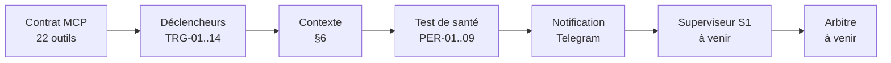

# Pont LLM2ROS — dossier de conception

Le pont relie le robot (Système 1, déterministe) à un agent de raisonnement (Système 2) par un
serveur MCP. Le Système 2 n'agit que sur sollicitation, par des outils typés, et jamais directement
sur un actionneur.

## Lire dans cet ordre

| Étape | Document | Ce qu'on y trouve |
|---|---|---|
| 1. Besoin | [[llm2ros_bridge_specification]] | 40 exigences fonctionnelles, 14 exigences non fonctionnelles du pont historique |
| 2. Contrat | [[llm2ros_mcp_specification]] | rôles S1/S2, 22 outils, 14 déclencheurs, contexte, sûreté, décisions |
| 3. Conception | [[llm2ros_bridge_design]] | modules, flux, états, erreurs, déploiement, ce qui manque |
| 4. Vérification | [[llm2ros_mcp_test_plan]] | architecture de la suite, isolation, cas nominaux et dégradés |
| 5. Traçabilité | [[llm2ros_traceabilite]] | matrice exigence → test, générée |
| 6. Périphériques | [[llm2ros_health_test_specification]] | contrôle de présence, verdicts, notification |

## Où en est le pont

| Brique | État | Preuve |
|---|---|---|
| Serveur MCP (catalogue, auth, ressources) | livré | 105 tests verts, session réelle initialisée |
| Déclencheurs et contexte | livré | 45 tests, latence mesurée |
| Test de santé et notification | livré | rapport réel en 7,2 s, service systemd au démarrage |
| Superviseur, arbitre, paramètres, actions | **non câblés** | les outils concernés refusent en `MCP-E-PREREQ` |

## Documents d'analyse du pont historique

| Document | Objet |
|---|---|
| [[llm2ros_bridge]] | état constaté du pont C++ en service (ports 8000/8001) |
| [[llm2ros_bridge_architecture]] | architecture constatée, 9 diagrammes |
| [[llm2ros_bridge_coherence_et_approche]] | 33 écarts relevés et approche cible E0→E6 |

Le pont C++ reste en service pendant la construction du pont MCP : les deux cohabitent, et
[[etat_noeuds_et_services]] montre lequel répond.

## Décisions ouvertes

| ID | Question | État |
|---|---|---|
| D-06 | seuil de tension basse batterie | proposition 11,0 V, non validée |
| D-07 | seuils de ressources (disque, mémoire, température) | proposition, non validée |
| D-08 | canal d'escalade humaine | audit + Telegram retenus pour le statut ; escalade à préciser |
| D-21 | seuils de cadence du test de santé | proposition appliquée, marquée `provisional` |

Les décisions tranchées (D-15, D-20, D-22, D-23) sont consignées dans les documents de
spécification correspondants, avec leur date et leur portée.

## Voir aussi

- [Architecture du robot](../robot/index.md)
- [[llm2ros_traceabilite]] — couverture réelle exigence par exigence
- [Agent Hermes](../hermes/index.md) — qui exécute les outils côté S2
