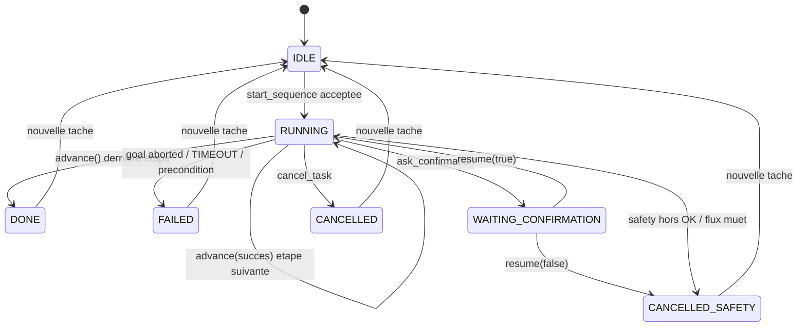

# Système 1 — directeur d'exécution (lot 3)

Retour à l'[[index]] ; conception : `docs/superpowers/specs/2026-11-11-architecture-s1-s2-design.md`
§5.2 et §6 ; arbitre réflexe : [[systeme1_arbitre]] ; surface MCP : [[mcp_hermes]].

## 1. Ce que le directeur fait, et ne fait pas

Il **exécute une séquence déclarée** par S2 : une étape = un skill + des arguments bornés, un goal
d'action par étape, `advance()` sur le résultat du goal. Il ne compose rien, n'invente aucune
étape, et ne décide jamais du sens d'une tâche. Il tient le `task_id`, vérifie les préconditions,
et publie son état.

| Identifiant | Valeur mesurée le 2026-11-11 14:08 |
|---|---|
| Paquet | `clawbot_director` 0.1.0 (`clawbot_director/`) |
| Modules | `director.py` (logique pure), `director_node.py` (ROS 2), `skills.py` (étape → goal) |
| Nœud | `/director` |
| Unité | `clawbot-director.service`, `User=jetson`, `Environment=HOME=/home/jetson`, `ROS_DOMAIN_ID=28`, `Requires=clawbot-safety-arbitrator.service` |
| État au relevé | `ActiveState=active`, démarré 14:04:44 CET |
| Service | `/director/command` (`clawbot_interfaces/srv/DirectorCommand`, `string request_json` → `string response_json`) |
| Topic | `/director/state` (`std_msgs/String`, JSON, 5 Hz même sans changement) |

## 2. Machine d'états



`RUNNING` signifie « un goal est en vol ». Un état terminal signifie qu'un goal s'est terminé ou
qu'il a été annulé. Les tâches terminales restent consultables : anneau des 20 dernières, avec
motif, horodatage et durée (`Director.get(task_id)`).

## 3. Préconditions et garde-fous

| Règle | Comportement mesuré |
|---|---|
| OK frais obligatoire | refus `PRECONDITION_FAILED` si `/safety/state` n'a jamais parlé, ou si le dernier message date de plus de 1,0 s |
| Sortie de OK | annulation `CANCELLED_SAFETY` de la tâche en cours, **médiane 1,90 ms, p95 2,2 ms, max 2,9 ms** (20 essais, domaine 99, `perf_counter`) |
| Flux muet | motif `safety_stale`, même code de sortie ; l'arbitre est mort ou bloqué, ce n'est pas un feu vert |
| Un seul skill actif | second appel → `BUSY` avec le `task_id` courant, avant toute validation du skill demandé |
| Délai par étape | `timeout_s` (défaut 30 s, bornes 0,1–120 s) → goal annulé, tâche `FAILED` motif `TIMEOUT` |
| Annulation | `cancel_goal_async` sur le goal en vol, y compris si l'annulation arrive avant que le handle n'existe |
| Un seul STOP | une annulation journalisée par valeur de défaut, même si `STOP` arrive 20 fois par seconde |

## 4. Table des skills (`skills.py`)

Une étape non exécutable est refusée **avant** que la tâche ne démarre : plus de tâche `ACCEPTED`
qui resterait `RUNNING` pour toujours.

| Skill | Action | État |
|---|---|---|
| `arm_move` | `/arm_controller/follow_joint_trajectory` (5 articulations, bornes ±rad, `duration_s` 0,5–10) | exécutable, jamais lancé sur le robot |
| `grip_set` | `/grip_controller/follow_joint_trajectory` (`grip_joint`, bornes −1,54 à 0) | exécutable, jamais lancé sur le robot |
| `navigate_to` | — | `INDISPONIBLE` : catalogue de waypoints absent (lot 5) |
| `grasp_object`, `follow_human`, `search_object` | — | `INDISPONIBLE` : perception et asservissement absents (lot 6) |
| `express_state` | — | `INDISPONIBLE` : LED et buzzer non câblés (lot 7) |
| `set_watch_mode` | — | `INDISPONIBLE` : sentinel absent (lot 4) |
| `look_at_board` | — | `INDISPONIBLE` : hors périmètre de cette version (échecs) |

Les primitives `arm_move` et `grip_set` ne sont **pas** exposées à S2 : la surface MCP garde
l'énumération d'intentions de la spec (`limits.allowed_skills`), et un skill non déclaré est refusé
en `MCP-E-ARG` avant tout appel ROS.

## 5. Surface MCP (25 outils)

| Outil | Sémantique | Lecture seule |
|---|---|---|
| `start_skill(skill, args)` | déclare un skill ; refus `MCP-E-ARG` hors énumération, `MCP-E-PREREQ` si le lot n'existe pas | non |
| `get_task(task_id)` | état, étape, motif d'une tâche en cours ou terminée ; `UNKNOWN_TASK` → `MCP-E-ARG` | oui |
| `cancel_task(task_id, reason)` | annulation au prochain point sûr ; motif `safety*` refusé (réservé à S1) | non |

Le pont n'embarque pas rclpy : `bridge_mcp.director_client` est lancé en sous-processus, JSON sur
stdin, JSON sur stdout. Coût mesuré d'un appel pont → directeur : **médiane 1,98 s, max 2,4 s sur
5 appels** (initialisation rclpy du client ponctuel).

## 6. Preuves de vérification (2026-11-11)

```text
colcon build (clean, 37 paquets)                  -> exit 0
pytest (pont, seuils, arbitre, bras, EKF, ...)   -> 212 passed, exit 0
hermes mcp test clawbot                           -> Tools discovered: 25
start_skill navigate_to (domaine 28)              -> INDISPONIBLE "catalogue de waypoints absent (lot 5)"
get_task (domaine 28)                             -> FOUND, state IDLE, safety OK, safety_age_s 0.005
```

Domaine 99, faux contrôleur de bras (`test/soutien_actions.py`) : séquence de 3 étapes → 3 goals →
`DONE` ; goal qui échoue → `FAILED` sans étape suivante ; goal muet → `TIMEOUT` + goal annulé ;
`STOP` → `CANCELLED_SAFETY` + goal annulé ; `cancel_task` → idem.

**Aucun mouvement réel** : `arm_move` n'a pas été lancé sur le robot. Le premier essai physique
exige l'opérateur, un dégagement mesuré et l'alimentation à portée de main.

## 7. Limites et pièges

- **Aucun skill physique** n'est branché : les six intentions de la spec refusent avec leur lot.
  Le directeur est prouvé de bout en bout sur une action simulée, pas sur le bras.
- **Registre en RAM** : un redémarrage du directeur repart à `IDLE` et n'annule aucun goal en vol.
  `ExecStop` qui annule et publie reste à écrire avant le premier skill physique.
- **Trois pièges rclpy** payés en écrivant ce lot :
  1. un `ActionServer` refuse les annulations par défaut (`default_cancel_callback` → REJECT) ;
     sans `cancel_callback` explicite, un faux serveur ne voit jamais d'annulation ;
  2. `_clients` est un attribut interne de `rclpy.Node` : l'écraser casse l'executor
     (`'tuple' object has no attribute '_executor_event'`) ;
  3. arrêt d'un serveur d'action en test : `executor.shutdown()`, puis `server.destroy()`, puis
     `node.destroy_node()` ; l'ordre inverse fait tomber le processus (abort rclcpp).
- Un bruit rclpy subsiste à l'extinction de 3 tests (« exception never retrieved: 'NoneType'
  object has no attribute 'trigger' »), sans effet sur les résultats.

## Voir aussi

[[systeme1_arbitre]] · [[mcp_hermes]] · [[manipulation_moveit]] · [[ros2_graph_clawbot]] ·
[[systemd_robot_services]] · [[index]]
