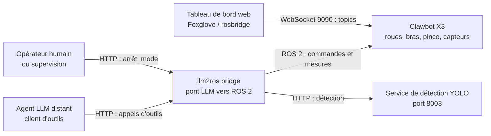
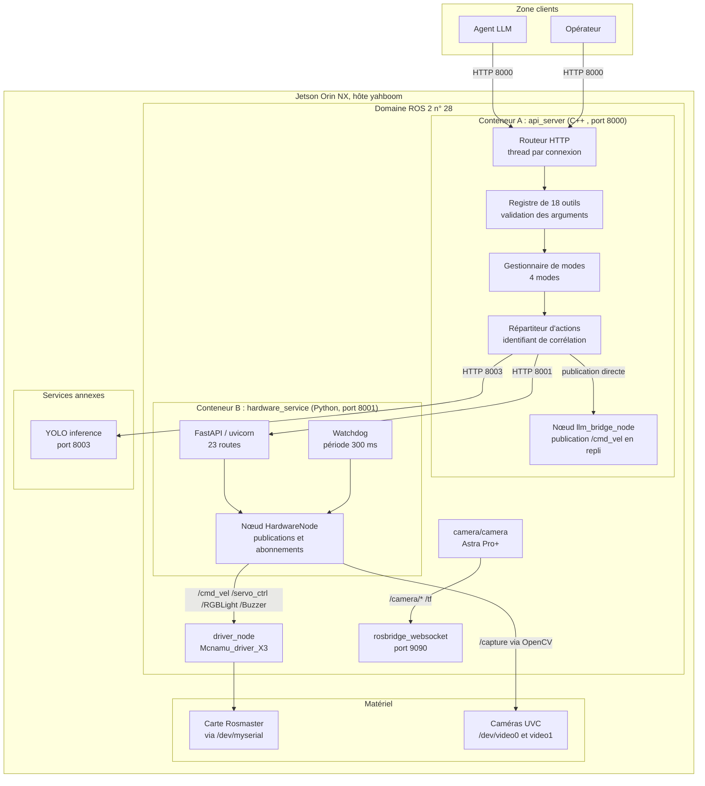
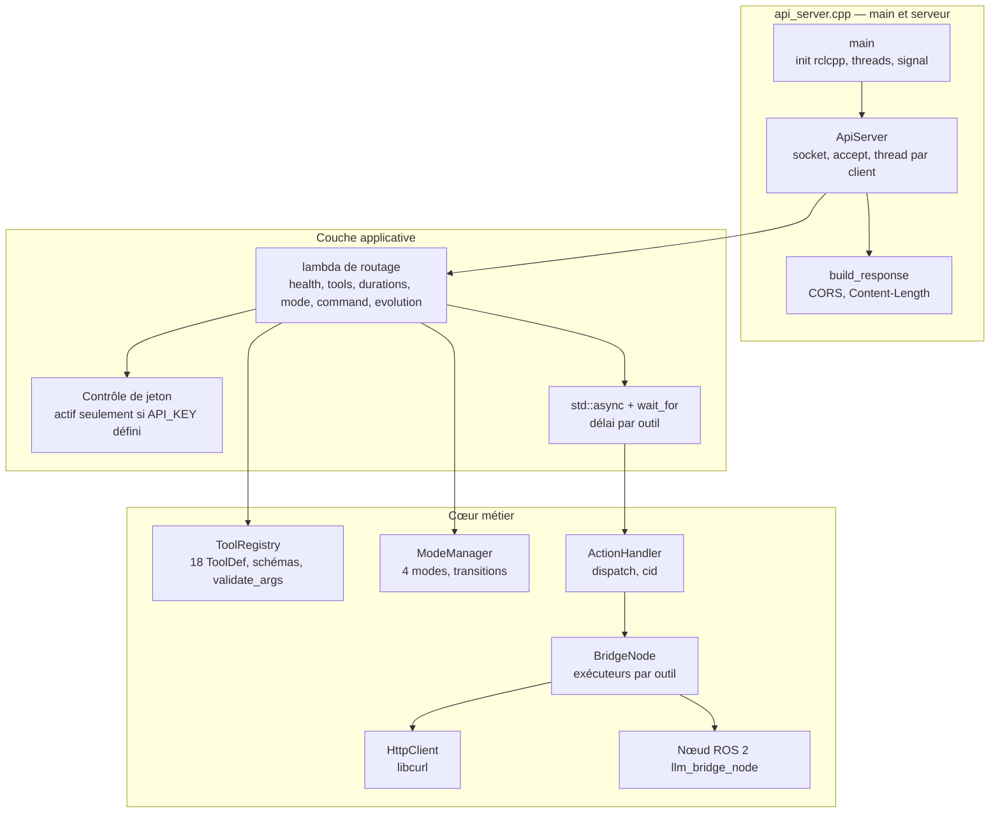
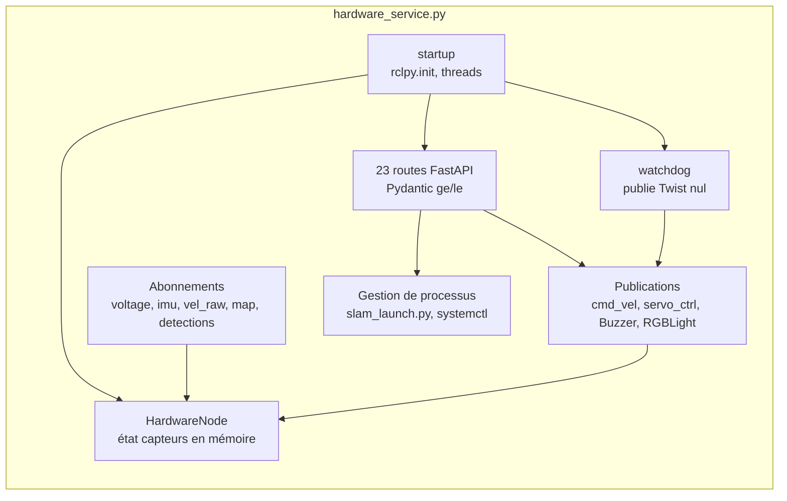
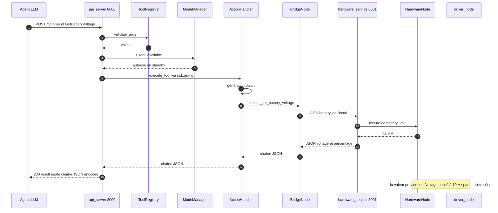
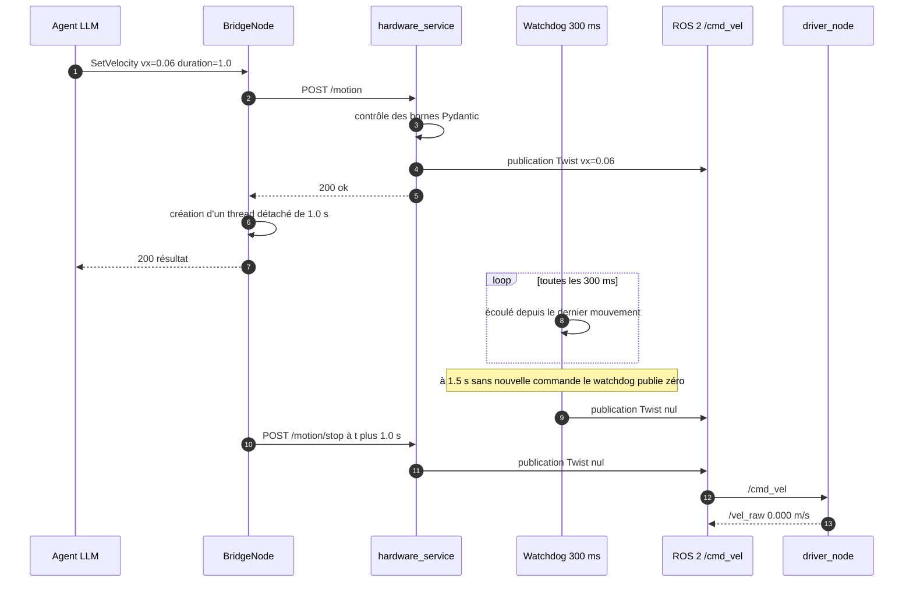
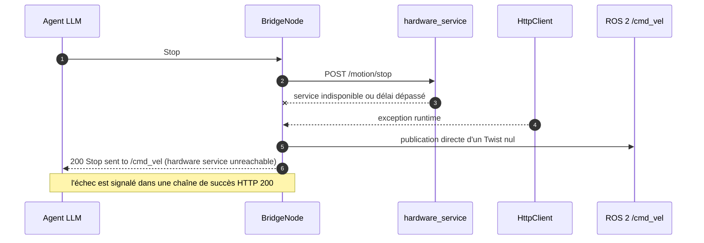
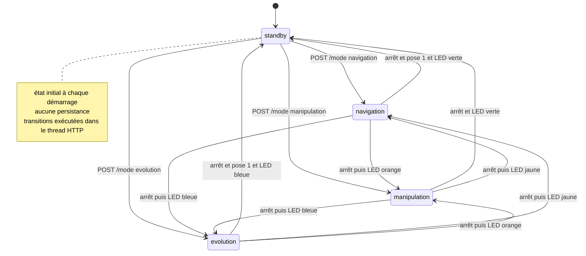
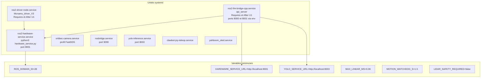

# llm2ros bridge — architecture

Document d'architecture du pont LLM → ROS 2 du Clawbot X3 : contexte, conteneurs, composants, séquences, états, déploiement et modèle de concurrence. Les diagrammes sont écrits en Mermaid (rendu par Obsidian, GitHub, VS Code) ; une vue ASCII les précède pour les lecteurs en terminal.

État constaté : [[llm2ros_bridge]]. Exigences : [[llm2ros_bridge_specification]]. Défauts et architecture cible : [[llm2ros_bridge_coherence_et_approche]].

## 1. Vue ASCII de synthèse

```
   Agent LLM / opérateur                 navigateur Foxglove / dashboard
            |                                        |
            | HTTP 8000 (aucune auth)                | ws 9090
            v                                        v
   +-------------------------+              +------------------+
   |  api_server  (C++)      |              |  rosbridge       |
   |  nœud llm_bridge_node   |              |  websocket       |
   |  18 outils, 4 modes     |              +------------------+
   +------------+------------+
                | HTTP local 8001 (libcurl, 10 s de délai)
                v
   +-------------------------+        +--------------------------+
   |  hardware_service       |  ROS2  |  driver_node             |
   |  (Python, FastAPI)      |------->|  Mcnamu_driver_X3        |
   |  nœud HardwareNode      |        |  /dev/myserial @115200   |
   |  watchdog 300 ms        |        +------------+-------------+
   |  23 routes REST         |                     |
   +------------+------------+                     v
                |                          carte Rosmaster (MCU)
                |                          roues, servos, pince
                v
   /cmd_vel  /servo_ctrl  /RGBLight  /Buzzer      (domaine ROS 2 = 28)
```

## 2. Contexte (C4 niveau 1)



## 3. Conteneurs (C4 niveau 2)

Deux processus exécutent le pont ; ils partagent le domaine DDS 28 et sont lancés par systemd.



| Lien | Protocole | Adresse | Authentification | Délai |
|---|---|---|---|---|
| Client → A | HTTP/1.1 | `0.0.0.0:8000` | Aucune (`API_KEY` non défini) | 10 s de réception |
| A → B | HTTP/1.1 via libcurl | `localhost:8001` | Aucune | 10 s (`HARDWARE_SERVICE_TIMEOUT`) |
| A → YOLO | HTTP/1.1 via libcurl | `localhost:8003` | Aucune | 15 s |
| A → ROS 2 | DDS | domaine 28 | — | — |
| B → ROS 2 | DDS | domaine 28 | — | — |
| Tableau de bord → robot | WebSocket | `0.0.0.0:9090` | Aucune | — |

## 4. Composants du conteneur A (C4 niveau 3)



| Composant | Fichier | Responsabilité | Dépendances |
|---|---|---|---|
| `ApiServer` | `src/api_server.cpp:140-295` | Socket TCP, analyse de la requête, réponse HTTP | POSIX sockets |
| Routage | `src/api_server.cpp:329-564` | Huit routes, authentification optionnelle, mode | `ApiServer`, `ToolRegistry`, `ModeManager` |
| `ToolRegistry` | `src/tool_schemas.cpp` | Description des 18 outils, génération des schémas, validation des arguments | `nlohmann::json` |
| `ModeManager` | `src/mode_manager.cpp` | Ensemble d'outils autorisés par mode, transitions | — |
| `ActionHandler` | `src/action_handler.cpp` | Validation, génération du `cid`, répartition vers `BridgeNode` | `ToolRegistry`, `BridgeNode` |
| `BridgeNode` | `src/bridge_node.cpp` | Traduction outil → HTTP 8001 ou commande système ; repli `/cmd_vel` | `HttpClient`, ROS 2 |
| `HttpClient` | `src/http_client.cpp` | GET/POST libcurl, levée d'exception sur code ≥ 400 | libcurl |

## 5. Composants du conteneur B (C4 niveau 3)



| Ressource partagée | Producteur | Consommateur | Mécanisme |
|---|---|---|---|
| Tension | `/voltage` (10 Hz) via `driver_node` | `/battery`, `/telemetry` | Attribut `battery_volt` |
| IMU | `/imu/data_raw` (10 Hz) | `/telemetry` | Attributs + horodatage |
| Vitesse mesurée | `/vel_raw` | `/telemetry` | Attributs + horodatage |
| Carte | `/map` (transient local) | `/map/live`, `/maps/save` | Dernier message conservé |
| Détections | `/detections`, `/camera/detection_image` | `/yolo/frame`, `/yolo/status` | Attributs + horodatage |
| Angles de servos | Commandes émises par l'API | `/telemetry` | Dernière consigne (pas de retour capteur) |

## 6. Séquence — appel nominal de lecture



Mesure associée : 39 à 51 ms pour l'aller-retour complet (10 appels, 2026-11-10 06:23).

## 7. Séquence — déplacement borné, auto-arrêt et watchdog



Points d'architecture : l'auto-arrêt du pont et le watchdog du service sont **deux mécanismes indépendants**, et le thread d'auto-arrêt n'est ni suivi ni annulable (voir ROB-01, ROB-03 dans [[llm2ros_bridge_coherence_et_approche]]).

## 8. Séquence — défaillance du service matériel



## 9. États — modes d'exploitation (implémentation actuelle)



Les routes `/evolution/build` et `/evolution/test` restent accessibles quel que soit l'état : elles ne figurent pas dans le diagramme de modes.

## 10. Déploiement



| Unité | Redémarrage | Dépendance déclarée | Utilisateur |
|---|---|---|---|
| `ros2-hardware-service.service` | — | aucune | `jetson` |
| `ros2-driver-node.service` | `Restart=on-failure`, 5 s | `Requires=ros2-hardware-service` | `jetson` |
| `ros2-llm-bridge-cpp.service` | `Restart=on-failure`, 3 s | `Requires=ros2-hardware-service` | `jetson` |

## 11. Modèle de concurrence

| Processus | Threads observés | Risque structurel |
|---|---|---|
| `api_server` | thread principal (accept non bloquant, pause 50 ms), thread `rclcpp::spin`, 1 thread détaché par connexion, 1 thread détaché par `SetVelocity` | Connexions et threads non bornés ; aucun verrou sur les actionneurs |
| `hardware_service` | boucle asyncio uvicorn, thread de spin ROS (démon), thread watchdog (démon, 300 ms) | État capteurs lu sans verrou depuis la boucle asyncio |
| `driver_node` | thread rclpy, thread de réception série de `Rosmaster_Lib` | Propriétaire exclusif de `/dev/myserial` |

## 12. Points d'intégration et couplage

| Interface | Type de couplage | Force | Remarque |
|---|---|---|---|
| A → B | HTTP synchrone | Fort | Toute indisponibilité de B dégrade A ; 12 routes de B non exposées |
| A → ROS 2 | DDS, publication `/cmd_vel` | Faible volume | Utilisé uniquement en repli d'échec |
| B → ROS 2 | DDS, 4 publications, 6 abonnements | Fort | Le service dépend de `driver_node` pour toute mesure |
| A → YOLO | HTTP synchrone | Moyen | Indisponibilité détectée à l'appel |
| Clients → A | HTTP sans authentification | Fort et non maîtrisé | Voir SEC-03 et SEC-04 |

## 13. Limites de cette description

Les diagrammes décrivent le comportement constaté et le code source au 2026-11-10 ; ils ne constituent pas une architecture cible. Les écarts, défauts et la cible sont traités dans [[llm2ros_bridge_coherence_et_approche]], et les exigences vérifiables dans [[llm2ros_bridge_specification]].

## 14. Voir aussi

- État constaté et mesures : [[llm2ros_bridge]]
- Analyse de cohérence et architecture cible : [[llm2ros_bridge_coherence_et_approche]]
- Exigences et recette : [[llm2ros_bridge_specification]]
- Défauts du graphe ROS 2 sous-jacent : [[ros2_graph_clawbot]], [[ros2_nav_stack]]
- Matériel piloté : [[rosmaster_x3_mcu]], [[orbbec_astra_pro_plus]], [[batterie_principale]]
- Services supervisés : [[systemd_robot_services]]
