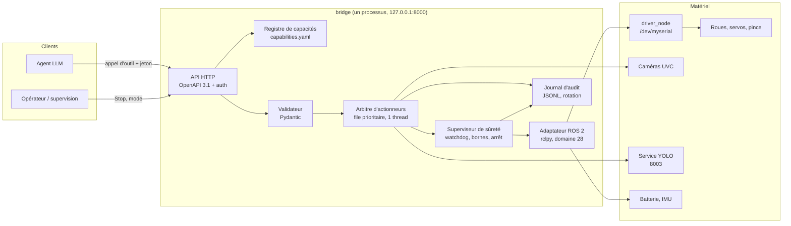
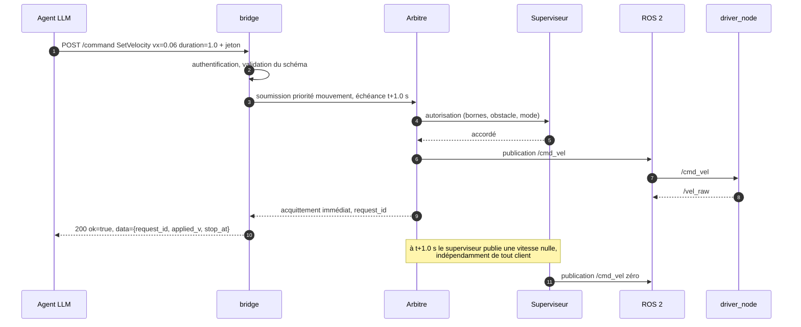
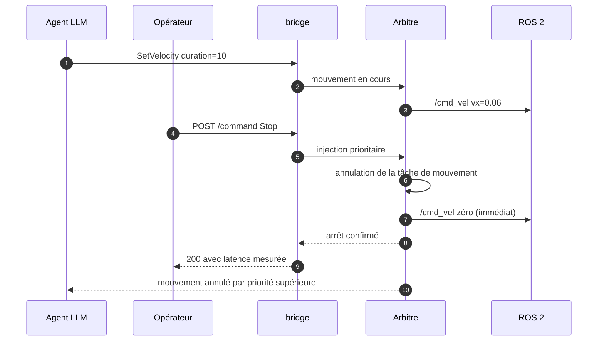
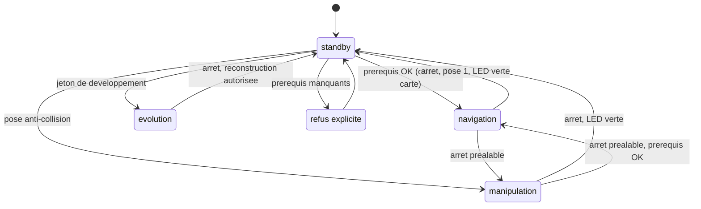
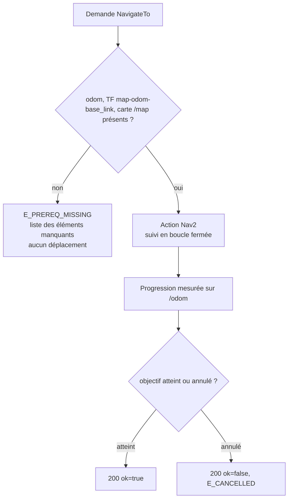

# llm2ros bridge — analyse de cohérence et approche retenue

Analyse des écarts entre ce que le pont fait, ce qu'il annonce et ce dont le robot a besoin, puis architecture cible et plan de migration. État constaté : [[llm2ros_bridge]]. Exigences : [[llm2ros_bridge_specification]]. Architecture détaillée du système actuel : [[llm2ros_bridge_architecture]].

## 1. Méthode et corpus

| Source | Volume / nature |
|---|---|
| `ros2_llm_bridge_cpp/` (composant déployé) | 6 fichiers source C++, 1 400 lignes environ, `CMakeLists.txt`, aucun test |
| `ros2_llm_bridge/` (composant historique) | `hardware_service.py` 979 lignes, 4 modules Python, 6 fichiers de tests |
| Documentation du dépôt | `README.md`, `PRD.md`, `nervous_system.md`, `docs/` |
| Mesures sur le système en exécution | 10 appels `/command`, captures `/capture`, `ss -ltnp`, `git status` |
| Preuve d'exécution de commande | [[ERR-2026-11-10-004_execution_de_commande_non_authentifiee]] |

## 2. Incohérences documentaires

| ID | Constat | Preuve | Conséquence |
|---|---|---|---|
| D-01 | Le nombre d'outils annoncé est 17, le service en publie 18 | `tool_schemas.cpp:2`, `README.md:6` contre `GET /tools` → 18 et `tests/test_cpp_bridge.py` qui attend 18 | Toute recette fondée sur la documentation échoue |
| D-02 | Le `README.md` attribue le port 8000 au service matériel et 5000 à la supervision | `README.md:30-31` contre `ss -ltnp` → 8000 = pont, 8001 = service matériel, aucune écoute sur 5000 | Diagnostic erroné en exploitation |
| D-03 | Le `PRD.md` décrit une pile Python (`llm_handler.py`, FastAPI sur 8000) | `PRD.md:11-14` ; `ls ros2_llm_bridge/ros2_llm_bridge/` ne contient pas `llm_handler.py` | Le document de référence décrit un système qui n'existe pas |
| D-04 | Le `README.md` déclare un conflit série entre service matériel et `driver_node` | `README.md:49` contre `hardware_service.py:6` (« driver_node keeps EXCLUSIVE access to /dev/myserial ») et l'absence de tout accès série dans le service | Contrainte d'exploitation inexistante maintenue |
| D-05 | Le `PRD.md` exige OpenAPI/Swagger et un endpoint `/health` | `PRD.md:94,153` contre `GET /openapi.json` → 404 sur 8000 | Contrat non documenté, pas d'essai client possible |
| D-06 | La suite de tests du pont cible le port 8002 | `tests/test_cpp_bridge.py:5` (`BRIDGE_URL = "http://localhost:8002"`) | `/evolution/test` teste une instance absente ; résultat non significatif |
| D-07 | La documentation annonce une détection d'obstacle par capteurs à ultrasons et une route `/execute_action` | `ros2_llm_bridge/docs/index.md` (§1 et §3) ; aucun capteur à ultrasons au `lsusb`, aucune route de ce nom (`/openapi.json` : 23 routes, `/motion` et `/command`) | Description matérielle et contractuelle fausse |
| D-08 | La conception déclare des fonctions vocales et un arrêt d'urgence laser non implémentés | `nervous_system.md` (réveil par nom, commande vocale, arrêt sur obstacle lidar, SLAM) contre `tool_schemas.cpp` (`Listen` : « STT requires whisper (not yet installed) ») et C-02 | Écart entre intention et service rendu |

## 3. Incohérences de contrat

| ID | Constat | Preuve | Effet |
|---|---|---|---|
| CTR-01 | Le résultat est une chaîne JSON encodée dans une chaîne JSON | `api_server.cpp:549` ; réponse mesurée : `{"result":"{\"voltage\":11.9,...}"}` | Double décodage obligatoire côté LLM ; tout client naïf lit une chaîne |
| CTR-02 | Une erreur d'exécution est renvoyée avec le code HTTP 200 | `bridge_node.cpp:84,94,217` renvoient `"ERROR: …"` ; `api_server.cpp:549-550` les emballe en 200 | Le LLM interprète un échec comme un succès |
| CTR-03 | `arguments` fourni sous forme de chaîne JSON est refusé | Vérifié en direct : `{"function":"Stop","arguments":"{}"}` → 400 « Arguments must be a JSON object » | Incompatibilité avec les clients qui sérialisent les arguments en chaîne |
| CTR-04 | Aucun identifiant de corrélation n'est retourné au client | `action_handler.cpp:45` génère un `cid`, jamais renvoyé ni journalisé en réponse | Rupture de traçabilité décision → action (EF-08, EF-09) |
| CTR-05 | Le dépassement de délai ne libère pas l'appelant | `api_server.cpp:538-546` : `std::async` + `wait_for`, puis destruction du `future` qui attend la fin | Le délai annoncé n'est pas respecté ; la réponse 504 arrive après l'exécution |
| CTR-06 | `SetVelocity` documente un écrêtage jamais renvoyé | `bridge_node.cpp:66` lit `clamped` ; `/motion` ne produit pas ce champ et rejette hors bornes en 422 | Message d'écrêtage inatteignable, code de retour incohérent avec le schéma |

## 4. Incohérences de sécurité

| ID | Constat | Preuve | Gravité |
|---|---|---|---|
| SEC-01 | Exécution de commande arbitraire via l'outil `Speak` | `bridge_node.cpp:106` (`std::system("espeak-ng \"" + text + "\"")`) ; preuve d'exécution : fichier créé par injection | Critique |
| SEC-02 | Exécution de commande arbitraire via `POST /evolution/build` | `api_server.cpp:385-388` concatène `package` dans une commande `colcon` exécutée par `std::system` | Critique |
| SEC-03 | Aucune authentification en production | `API_KEY` absent de toutes les unités systemd ; `GET /health` sans jeton → 200 | Critique |
| SEC-04 | Écoute sur toutes les interfaces | `api_server.cpp:165` (`INADDR_ANY`) ; `http://192.168.1.47:8000/health` → 200 | Critique |
| SEC-05 | CORS ouvert à toute origine | `api_server.cpp:72` (`Access-Control-Allow-Origin: *`) | Majeur |
| SEC-06 | Routes de développement hors du contrôle de mode | `/evolution/*` ne consulte pas `ModeManager` ; en mode `standby` elles restent accessibles | Majeur |
| SEC-07 | Aucune limitation de débit ni de taille de corps | `api_server.cpp:196` thread par connexion, tampon 64 Ko, pas de quota | Majeur |
| SEC-08 | Transport en clair, sans TLS | `http://`, aucune terminaison TLS | Majeur |

## 5. Incohérences de sûreté de fonctionnement

| ID | Constat | Preuve | Effet |
|---|---|---|---|
| ROB-01 | Les auto-arrêts de mouvement sont des threads détachés, non annulables | `bridge_node.cpp:70-77` | Deux commandes rapprochées : l'arrêt de la première coupe la seconde |
| ROB-02 | Aucune sérialisation des actions : deux clients peuvent agir simultanément | `api_server.cpp:196` + absence de mutex dans `action_handler.cpp` | Conflits d'actionneurs, ordre non déterministe |
| ROB-03 | Le watchdog republie une vitesse nulle indéfiniment après le premier mouvement | `hardware_service.py:190-199` : `_last_motion_t` jamais remis à 0 | Trafic DDS continu, arrêt répété toutes les 0,3 s |
| ROB-04 | La navigation se fait en boucle ouverte, sans odométrie ni TF | `bridge_node.cpp:131-170` ; `/odom` absent, `base_link` absent du TF | Déplacement non mesuré, non borné spatialement |
| ROB-05 | L'arrêt de repli publie directement sur `/cmd_vel`, hors service matériel | `bridge_node.cpp:96-97` | Contourne le watchdog et les limites du service |
| ROB-06 | Une URL malformée peut arrêter le processus | `api_server.cpp:86-99` : `std::stoi` hors `try` | Déni de service trivial |
| ROB-07 | Les réponses volumineuses ne sont pas écrites intégralement | `api_server.cpp:293` : un seul `send()` sans boucle | JSON tronqué sur image ; mesuré : capture 47 834 o |
| ROB-08 | Aucun arrêt propre des actionneurs à la terminaison | `api_server.cpp:567-573` : `rclcpp::shutdown` sans commande d'arrêt | Robot pouvant rester en mouvement après redémarrage du service |
| ROB-09 | Le mode n'est ni persistant ni protégé : tout client peut en changer | `mode_manager.cpp:69-91` | Perte de l'état au redémarrage, changement de mode non authentifié |

## 6. Incohérences fonctionnelles

| ID | Constat | Preuve | Effet |
|---|---|---|---|
| FON-01 | Trois jeux de bornes de vitesse coexistent | 0,06 (schéma) / 0,05 (navigation) / 0,5 (défaut du service) et 0,06 via l'environnement | Comportement dépendant du mode de démarrage |
| FON-02 | La caméra `claw` est annoncée et configurée sur l'index 2, absent du système, alors que la caméra physique est sur l'index 0 | `tool_schemas.cpp:80,85` ; `CAMERA_CLAW_INDEX=2` ; `ls /dev/video*` → `video0`, `video1` ; `GET /detect_raw?camera=claw` → HTTP 500 `Cannot open camera claw (index 2)` ; `?camera=front` → HTTP 200 (relevé 2026-11-10T19:12+01:00) | Outil annoncé non fonctionnel ; l'outil `front` ouvre la caméra du bras ([[camera_usb_bras]]) |
| FON-03 | Douze routes du service matériel ne sont pas exposées au LLM | Comparaison `/openapi.json` (8001, 23 routes) et `/tools` (8000, 18 outils) | Télémétrie, cartes et SLAM inaccessibles à l'agent |
| FON-04 | L'état de charge est une interpolation linéaire présentée comme une courbe LiPo | `hardware_service.py:506` ; `tool_schemas.cpp:211-212` | Erreur de mesure non quantifiée, présentée comme une courbe |
| FON-05 | `NavigateTo` promet un référentiel `map` que le robot ne publie pas | `tool_schemas.cpp:67-70` ; `/map` sans éditeur | Contrat impossible à satisfaire |
| FON-06 | Le mode `evolution` restreint les outils mais laisse ouvertes les routes de compilation | `mode_manager.cpp:42-45` contre `api_server.cpp:381-418` | Le mode ne protège pas ce qu'il est censé protéger |
| FON-07 | La sonde de santé PER-01 associe au topic couleur le couple `0c45:6340` et `/dev/video0`, qui appartiennent à la caméra du bras, alors que `/camera/color/image_raw` est publié par la fonction `2bc5:050f` de l'Astra | `bridge_mcp/health.py:119` ; `lsusb -t` (`Dev 15` = `usbfs`, `Dev 16` = `uvcvideo`) ; `/proc/6287/fd` | La sonde valide une caméra et un topic sans lien de causalité : la panne de l'une ne serait pas vue |

## 7. Incohérences d'ingénierie

| ID | Constat | Preuve |
|---|---|---|
| ING-01 | Le composant déployé n'est pas versionné | `git status --porcelain` → `?? ros2_llm_bridge_cpp/` |
| ING-02 | Aucun test du composant C++ | `CMakeLists.txt` sans `BUILD_TESTING` ; 0 test |
| ING-03 | Deux implémentations complètes du même pont, non synchronisées | `ros2_llm_bridge/` (Python) et `ros2_llm_bridge_cpp/` (C++) |
| ING-04 | Les schémas, la validation et la documentation sont trois sources indépendantes | `tool_schemas.cpp` (schéma + validation), `hardware_service.py` (bornes Pydantic), `PRD.md` |

## 8. Synthèse par exigence violée

| Exigence | Statut | Incohérences liées |
|---|---|---|
| EF-02, ENF-13 (source unique) | Non satisfaite | FON-01, ING-04 |
| EF-03, EF-04 (contrat de réponse et d'entrée) | Non satisfaite | CTR-01, CTR-03 |
| EF-05 (codes d'erreur) | Non satisfaite | CTR-02 |
| EF-08, EF-09, EF-10 (traçabilité) | Non satisfaite | CTR-04 |
| EF-12, EF-13 (sérialisation, priorité) | Non satisfaite | ROB-01, ROB-02, ROB-05 |
| EF-15 (bornes uniques) | Non satisfaite | FON-01, CTR-06 |
| EF-16 à EF-18 (navigation) | Non satisfaite | ROB-04, FON-05, C-03 |
| EF-19, EF-21 (caméras) | Non satisfaite | FON-02 |
| EF-27, EF-28 (synthèse vocale sans shell) | Non satisfaite | SEC-01 |
| EF-33, EF-40 (télémétrie, cartographie) | Non satisfaite | FON-03 |
| EF-36, EF-37 (modes persistants, routes dev) | Non satisfaite | ROB-09, SEC-06, FON-06 |
| ENF-04, ENF-05 (robustesse, intégrité) | Non satisfaite | ROB-06, ROB-07 |
| ENF-07, ENF-08, ENF-09 (sécurité réseau) | Non satisfaite | SEC-03, SEC-04, SEC-05, SEC-07 |
| ENF-11, ENF-12 (tests) | Non satisfaite | ING-02, D-06 |

## 9. Approche retenue — cinq décisions

| Décision | Choix | Justification mesurée |
|---|---|---|
| D1 — Nombre de services | Fusionner le pont C++ et le service matériel en **un seul processus** qui possède à la fois le contrat d'outils et l'accès ROS 2 | La latence mesurée (39–51 ms) est dominée par le saut HTTP 8000 → 8001 ; la fusion supprime une couche de validation dupliquée et le double encodage |
| D2 — Langage hôte | **Python 3.10 / FastAPI / rclpy**, en conservant `hardware_service.py` comme base | OpenAPI 3.1 et Pydantic déjà présents sur 8001 (`/openapi.json`, 15 670 o) ; tests pytest existants ; supprime 1 400 lignes C++ non versionnées et non testées |
| D3 — Contrat | Un fichier `capabilities.yaml` unique, générateur vers schémas OpenAI, Anthropic, validation Pydantic et OpenAPI | Supprime ING-04 et FON-01 par construction |
| D4 — Exécution | Un **arbitre d'actionneurs** à thread unique, à file prioritaire (`Stop` > mouvement > bras > périphériques), avec un watchdog unique hors du chemin HTTP | Supprime ROB-01, ROB-02, ROB-05 et rend EF-13 mesurable |
| D5 — Sécurité | Écoute sur `127.0.0.1` par défaut, jeton obligatoire hors boucle locale, aucun interpréteur de commandes dans le chemin d'exécution, routes de développement absentes en production | Supprime SEC-01 à SEC-08 ; la surface d'attaque se limite à un socket local et à des outils validés |

### 9.1 Matrice de décision (pondération : risque 40 %, coût 25 %, testabilité 20 %, latence 15 %)

| Option | Risque | Coût | Testabilité | Latence | Total |
|---|---|---|---|---|---|
| O1 — Durcir les deux services existants | Élevé : deux contrats, deux validations, injection inchangée dans le C++ | Faible | Moyenne | 39–51 ms | 2,4 / 5 |
| O2 — Fusion Python unique (retenue) | Faible : un contrat, une validation, code testé existant | Moyen : reprise de 18 outils en Python | Élevée : FastAPI, pytest, OpenAPI | < 10 ms attendus | 4,1 / 5 |
| O3 — Fusion C++ unique | Moyen : code non versionné, zéro test, HTTP artisanal à réécrire | Élevé | Faible | < 10 ms | 2,8 / 5 |

Note de méthode : les valeurs de latence de O2 et O3 sont des objectifs d'ingénierie, non des mesures. Le seul chiffre mesuré est la latence actuelle du chemin complet : 39–51 ms.

### 9.2 Architecture cible

### 9.3 Séquence nominale d'un déplacement borné

### 9.4 Priorité de l'arrêt

### 9.5 Modes et transitions

Toute transition exécute, dans l'ordre : arrêt des actionneurs, application de la pose, signalisation, puis publication du nouvel état. L'état est persisté et relu au démarrage.

### 9.6 Dégradation explicite quand les prérequis manquent

## 10. Plan de migration

| Étape | Contenu | Porte de sortie |
|---|---|---|
| E0 — Confinement (immédiat) | `127.0.0.1` sur 8000 et 8001, `API_KEY` obligatoire, retrait de `/evolution/build` et `/evolution/test`, remplacement de `std::system` par `posix_spawn` avec arguments séparés | Recette 4, 5 et 8 du cahier des charges ; aucune régression fonctionnelle |
| E1 — Contrat | `capabilities.yaml`, génération des schémas, réponse `{ok, data, error}`, `request_id`, acceptation des deux formes d'`arguments` | Recette 1, 2 |
| E2 — Arbitre | File prioritaire, annulation, watchdog unique, `Stop` prioritaire, arrêt propre sur SIGTERM | Recette 3 ; test de concurrence à 8 clients |
| E3 — Fusion | Reprise des 18 outils dans le service Python unique, retrait du binaire C++ et de son unité systemd | Recette complète, latence p95 < 150 ms |
| E4 — Observabilité et audit | Métriques, journal JSONL avec `request_id`, rotation adaptée aux 4,3 Go libres | ENF-10 ; volume quotidien mesuré |
| E5 — Prérequis navigation | Odométrie et TF (`robot_state_publisher`, `base_link`, `odom`), puis Nav2 ; sans quoi `NavigateTo` reste refusé | Recette 7 ; [[ERR-2026-11-10-003_arbre_tf_incomplet]] close |
| E6 — Tests et versionnement | Tests de contrat, de propriétés, d'injection, d'intégration avec matériel simulé ; mise sous gestion de version | ENF-11, ENF-12, EF-06 |

Ordre imposé : E0 avant toute exposition réseau, E1 avant E2 (l'arbitre consomme le contrat), E3 après E2 pour ne pas déplacer deux fois la même logique.

## 11. Risques résiduels assumés

| Risque | Traitement |
|---|---|
| Navigation impossible sans odométrie ni TF | Outil refusé explicitement jusqu'à E5 ; aucun substitut en boucle ouverte |
| Absence de source laser | Arrêt sur durée et watchdog uniquement ; `LIDAR_SAFETY_REQUIRED=false` reste une décision d'exploitation à documenter dans le mode d'emploi |
| Partition à 97 % | Journal d'audit avec rotation et quota ; capture d'images en RAM sauf demande explicite |
| Dépendance à un LLM externe | Le pont ne dépend d'aucun fournisseur : contrat JSON standard, deux formats de schémas |

## 12. Voir aussi

- État constaté : [[llm2ros_bridge]]
- Architecture détaillée du système actuel : [[llm2ros_bridge_architecture]]
- Exigences et recette : [[llm2ros_bridge_specification]]
- Trace de sécurité : [[ERR-2026-11-10-004_execution_de_commande_non_authentifiee]]
- Défauts du middleware sous-jacent : [[ros2_graph_clawbot]], [[ros2_nav_stack]]
