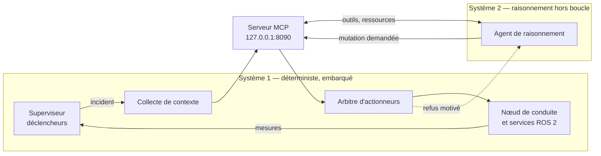
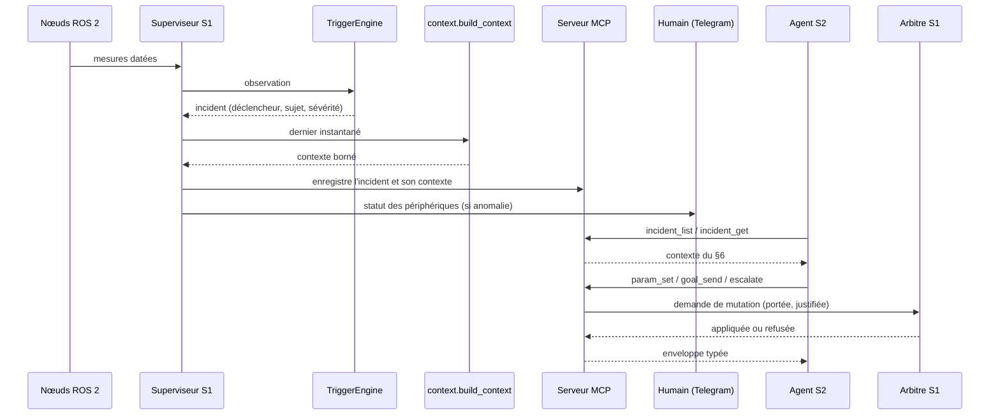
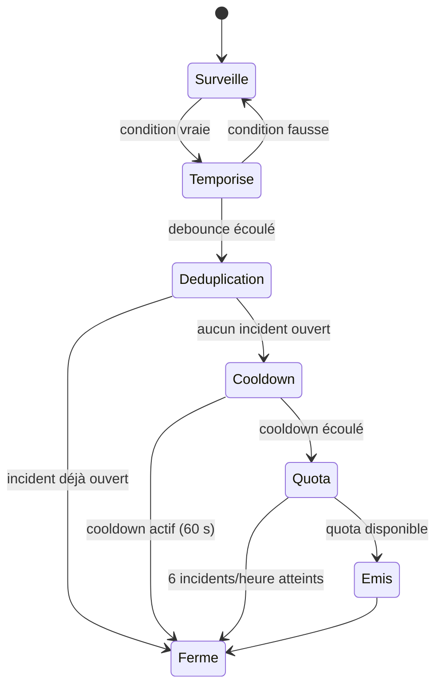

# Conception détaillée du pont LLM2ROS

Ce document décrit **comment** le pont est construit : modules, flux, états, erreurs, sûreté,
déploiement. Il ne redéfinit pas les exigences — celles-ci vivent dans
[[llm2ros_mcp_specification]] et [[llm2ros_health_test_specification]] — et ne raconte pas l'état
constaté du pont historique, décrit dans [[llm2ros_bridge]].

## 1. Frontières et principe directeur

Trois règles de conception, appliquées partout :

1. **S2 ne touche jamais un actionneur.** Il appelle des outils ; les mutations passent par
   l'arbitre de S1, qui applique bornes, priorités et watchdog. Aucun outil MCP ne publie sur un
   topic (exigence SAF-01).
2. **Un chemin non câblé refuse.** Un outil dont la couche basse manque retourne `MCP-E-PREREQ`
   en nommant le prérequis. Simuler un succès apprendrait à l'opérateur à croire le robot arrêté.
3. **La mesure précède la décision.** Le test de santé et les sondes produisent des mesures
   datées ; le moteur de déclenchement décide ; l'agent ne voit que le contexte et le verdict.

## 2. Modules et responsabilités

| Module | Responsabilité | Ne fait pas |
|---|---|---|
| `bridge_mcp/contract.py` | données de spécification : 22 outils, 8 codes d'erreur, 5 statuts, 3 ressources, révision MCP | aucune logique |
| `bridge_mcp/server.py` | construction du serveur, garde du transport, démarrage | aucune règle métier |
| `bridge_mcp/auth.py` | jeton porteur à temps constant, liste blanche d'en-têtes `Host` | aucune autorisation par outil |
| `bridge_mcp/envelope.py` | enveloppes `{status, data\|error}` et refus typés | aucune décision |
| `bridge_mcp/tools.py` | les 22 outils et 3 ressources, annotations, validation d'entrée | aucune écriture d'actionneur |
| `bridge_mcp/state.py` | incidents, journal d'audit en ajout seul, verrou d'arrêt | aucune persistance disque |
| `bridge_mcp/limits.py` | limites effectives (vitesses, watchdog, listes blanches) | aucune valeur inventée |
| `bridge_mcp/observations.py` | structures de mesure passives | aucune lecture ROS |
| `bridge_mcp/triggers.py` | 14 déclencheurs, temporisation, cooldown, débit, reprises | aucune collecte de contexte |
| `bridge_mcp/context.py` | assemblage du contexte §6, bornes, absences déclarées | aucun calcul de verdict |
| `bridge_mcp/health.py` | inventaire PER-01..09, sondes, rapport, CLI | aucune action corrective |
| `bridge_mcp/notify.py` | message humain, envoi Telegram | aucun secret dans le rapport |

## 3. Cycle d'un incident

Latence mesurée du cycle de mesure : 7,2 s pour l'ensemble des sondes (fenêtre ROS de 5 s plus
1,5 s de découverte), soit sous la borne de 10 s de HLT-05.

## 4. Modèle de déclenchement

Ordre d'évaluation, tel qu'implémenté dans `TriggerEngine.observe` : reprise applicable →
incident ouvert sur le même couple (déclencheur, sujet) → temporisation → cooldown → quota →
émission. Cet ordre est une décision de conception : la déduplication passe **avant** la
temporisation, sinon le compteur d'occurrences reste figé à 1 pendant toute la durée de
l'incident.

Les 14 déclencheurs, leurs seuils et leurs jeux d'outils sont dans [[llm2ros_mcp_specification]] §3.
Deux seuils (tension basse, disque libre) restent des propositions : ils sont marqués
`provisional` dans le contexte et dans le rapport de santé.

## 5. Modèle d'erreur

| Code | Situation | Effet côté S2 |
|---|---|---|
| `MCP-E-AUTH` | jeton absent ou invalide | aucune exécution, 401 |
| `MCP-E-ARG` | argument manquant ou hors type | rien n'est tenté |
| `MCP-E-MODE` | incident clos, mutation interdite dans cet état | rien n'est tenté |
| `MCP-E-BOUNDS` | valeur hors bornes ou paramètre hors liste blanche | rien n'est écrit |
| `MCP-E-PREREQ` | couche basse non câblée, action non déclarée | refus explicite, jamais un succès |
| `MCP-E-BUSY` | mutation déjà en cours | rejouer plus tard |
| `MCP-E-TIMEOUT` | délai de l'outil dépassé | état supposé inchangé |
| `MCP-E-INTERNAL` | défaut interne | incident séparé, audit |

Deux limites connues, documentées plutôt que masquées : le SDK annonce toujours la capacité
`prompts` même vide (D-16), et un outil inconnu est refusé par le SDK avant d'atteindre le serveur,
donc sans code `MCP-E-*` (D-17).

## 6. Contexte transmis

Blocs obligatoires (CTX-01) : `schema_version`, `incident_id`, `created_at`, `trigger`, `robot`,
`graph`, `tf`, `diagnostics`, `params`, `resources`, `limits`, `unavailable`. Bornes : 256 Ko,
200 topics, 200 entrées de journal. Toute mesure porte son âge ; toute absence porte un code
(`ROS2-TOPIC-ABSENT`, `TF-FRAME-MISSING`, `ENOENT`, `HLT-E-NOT-INSTALLED`).

Sur ce robot, `unavailable` contient systématiquement `/scan`, `/odom`, `base_link`, `odom`, `map`
et l'état de charge de la batterie : ce sont des absences structurelles, pas des pannes.

## 7. Sûreté

| Mesure | Implémentation | Vérification |
|---|---|---|
| Authentification | jeton porteur, `hmac.compare_digest`, refus 401 | 3 tests de transport |
| Boucle locale | `create_server` refuse une interface non locale | test de non-joignabilité LAN |
| Rebinding DNS | liste blanche d'en-têtes `Host` (nom d'hôte, pas de port) | test d'en-tête étranger |
| Aucune écriture d'actionneur | catalogue sans publication ; invariant de test sur les mutations | `test_no_tool_can_write_an_actuator_topic` |
| Arrêt honnête | `safety_stop` refuse tant que l'arbitre n'est pas câblé | test de refus explicite |
| Secrets | jeton lu dans un fichier 600, jamais journalisé | analyse du rapport et du message |

## 8. Déploiement

| Élément | Valeur |
|---|---|
| Serveur MCP | `127.0.0.1:8090`, chemin `/mcp`, HTTP streaming, jeton obligatoire |
| Jeton | `/etc/clawbot/mcp-token` (600) — non créé à ce jour |
| Notification | `/etc/clawbot/telegram-token`, `/etc/clawbot/telegram-chat` |
| Test de santé | `clawbot-health.service` (oneshot au démarrage, `--service-mode`) |
| Documentation | `clawbot-docs.service`, port 8080 |
| Domaine ROS 2 | 28 pour le robot, 99 pour les tests (refus explicite du 28 en test) |

## 9. Ce qui n'est pas encore câblé

Cette section est volontairement explicite : elle liste ce qui manque, pas ce qui marche.

| Manque | Conséquence actuelle | Incrément prévu |
|---|---|---|
| Superviseur de S1 (boucle de mesure) | `TriggerEngine` n'est alimenté par personne en service | prochain incrément |
| Arbitre d'actionneurs | `safety_stop` et les mutations refusent en `MCP-E-PREREQ` | après le superviseur |
| Pont de paramètres | `param_get`, `param_set` refusent | après l'arbitre |
| Client d'action | `goal_send`, `goal_cancel` refusent | après l'arbitre |
| Jeton MCP | le serveur refuse de démarrer sans jeton : aucun service ne le lance encore | déploiement |

## 10. Tests

`tests/mcp_bridge` : 105 tests, répartis en contrat MCP (35), déclencheurs et contexte (45),
santé et notification (25). Deux environnements vérifiés (shell nu, shell ROS chargé), domaine 99,
port éphémère, jeton unique par test, aucun accès au robot réel.

La correspondance exigence → test est tenue par [[llm2ros_traceabilite]], régénérée à chaque
évolution.

## 11. Voir aussi

- [[llm2ros_mcp_specification]] — exigences de l'interface MCP et des déclencheurs
- [[llm2ros_mcp_test_plan]] — architecture de la suite
- [[llm2ros_health_test_specification]] — contrôle de présence des périphériques
- [[llm2ros_traceabilite]] — matrice générée
- [[llm2ros_bridge_architecture]] — architecture du pont C++ en service
- [[etat_noeuds_et_services]] — état d'exécution relevé
