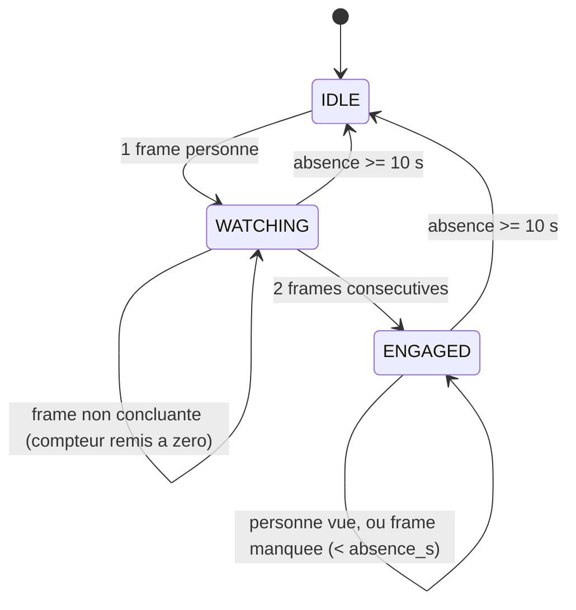

# Système 1 — sentinel (lot 4)

Retour à l'[[index]] ; conception : `docs/superpowers/specs/2026-11-11-architecture-s1-s2-design.md`
§5.3 et §7 ; directeur : [[directeur_s1]] ; pont et réveil : [[mcp_hermes]].

## 1. Identité

| Élément | Valeur mesurée le 2026-11-11 14:13 |
|---|---|
| Paquet | `clawbot_sentinel` 0.1.0 |
| Modules | `attention.py` (machine pure), `words.py` (mots d'arrêt, oui/non), `depth.py` (distance), `sentinel_node.py` (nœud) |
| Nœud | `/sentinel` |
| Unité | `clawbot-sentinel.service`, `User=jetson`, `ROS_DOMAIN_ID=28`, `Requires=clawbot-director.service` |
| État au relevé | `active`, démarré 14:13:47 CET |
| Entrées | YOLO `http://127.0.0.1:8003/detect_raw` à 1 Hz, `/camera/depth/image_raw`, `/sentinel/transcript`, `/director/state` |
| Sorties | `/sentinel/state` (2 Hz, JSON), `/sentinel/event` (JSON), `/cmd_vel` (consigne nulle sur arrêt local) |

## 2. Machine d'attention



| Règle | Valeur | Source |
|---|---|---|
| Confiance minimale | 0,75 | spec §5.3 |
| Distance maximale | 3,5 m | spec §5.3 |
| Frames consécutives | 2 | spec §5.3 |
| Absence avant retour en veille | 10 s | hygiène : une frame manquée ne désengage pas |
| Cooldown visuel | 60 s | spec §5.3 |
| Cooldown audio | 5 s | spec §5.3 |

Le réveil n'est émis que sur **transition**, jamais par frame : `Attention.voir()` et
`Attention.entendre()` renvoient une liste d'événements, le nœud ne réveille que sur `REVEIL`.

Distance : médiane d'une fenêtre 11 × 11 px au centre de la boîte, zéros et NaN ignorés ;
`16UC1` converti des millimètres, `32FC1` lu en mètres. Une distance inconnue **ne satisfait pas**
le critère : sans profondeur, pas d'engagement, et `depth_available` le dit dans `/sentinel/state`.

## 3. Parole locale

| Entrée | Condition | Effet |
|---|---|---|
| « stop », « arrête-toi », « halte », « arrêt » | toujours, hors réseau | consigne nulle sur `/cmd_vel` + `cancel_task` motif `voix_arret`, événement `ARRET_LOCAL` |
| « oui » / « non » | directeur en `WAITING_CONFIRMATION` | `confirm` au directeur (`accepte: true/false`) |
| « oui » / « non » hors attente | — | non consommé, la phrase appartient à S2 |
| phrase quelconque | — | ignorée |

Normalisation : minuscules, accents retirés, apostrophes et tirets en espaces, ponctuation en
espaces ; comparaison par **jeton**, donc « le stopwatch tourne » ne déclenche rien.

Le sentinel n'écrit jamais sur `/cmd_vel_safe` (propriété de l'arbitre) : il publie sur `/cmd_vel`,
l'entrée de l'arbitre, comme le ferait un opérateur (priorité 0,5).

## 4. Réveil de S2

| Source | Déclencheur | Anti-rebond |
|---|---|---|
| `VISUAL_PERSON` | passage `WATCHING → ENGAGED` | cooldown 60 s |
| `AUDIO_VAD` | activité vocale | cooldown 5 s (aucun producteur branché, voir §6) |
| `TASK_TERMINAL` | `/director/state` en `DONE`, `FAILED`, `CANCELLED`, `CANCELLED_SAFETY`, porteur d'un `task_id` | 2 s **et** mémoire du `task_id` : 3 s de publications à 5 Hz ne produisent qu'un réveil |

Charge utile : `trigger_type`, `source`, `timestamp`, `event_data` (distance, ou `task_id`/`state`/
`reason`), `robot_snapshot` (`visible_person`, `seconds_since_person`, `director_state`,
`attention`). Voie : `bridge_mcp.hermes_trigger.post_webhook` (POST HMAC vers la passerelle). Si la
passerelle est absente, l'échec est journalisé et `delivered: false` est publié sur
`/sentinel/event` — aucun réveil n'est inventé.

## 5. Preuves de vérification (2026-11-11)

```text
colcon build (clean, 38 paquets)                 -> exit 0
pytest (pont, seuils, arbitre, bras, EKF, sentinel, ...) -> 236 passed, exit 0
sentinel : 23 tests (attention 7, mots 5, profondeur 5, noeud 6)
ros2 topic echo /sentinel/state (domaine 28)     -> state IDLE, person_seen false,
                                                    director_state IDLE, depth_available true
```

Trois mutations ont été appliquées au code pour vérifier que les tests mordent : retirer la règle
des deux frames, retirer la détection des mots d'arrêt, retirer la mémoire du `task_id` de fin de
tâche. Les trois font échouer la suite ; la troisième n'a mordu qu'après avoir étendu le test
au-delà de l'anti-rebond de 2 s — un test qui n'observe que 1 s ne distingue pas les deux
mécanismes.

## 6. Limites

- **Aucun VAD ni STT branché** : `/sentinel/transcript` est la couture. Tant que rien ne publie
  dessus, les mots d'arrêt locaux sont prouvés en test mais inopérants en réel.
- **Pas de repli Telegram** : la règle « personne depuis 60 s → Telegram » n'est pas implémentée ;
  il n'existe aucun canal Telegram configuré.
- **Réveil webhook non actif** : la passerelle Hermes doit être redémarrée pour que le port 8644
  écoute ; jusque-là le sentinel journalise ses échecs de POST et publie `delivered: false`.
- **YOLO par défaut** : l'appel `/detect_raw` ne fixe pas de caméra ; l'index utilisé est celui du
  service, pas une propriété du sentinel.
- Le sentinel interroge YOLO dans un fil séparé ; un capteur qui tombe est journalisé et traité
  comme « personne absente », jamais comme une exception qui tue le nœud.

## Voir aussi

[[directeur_s1]] · [[systeme1_arbitre]] · [[mcp_hermes]] · [[inventaire_materiel]] ·
[[systemd_robot_services]] · [[index]]
