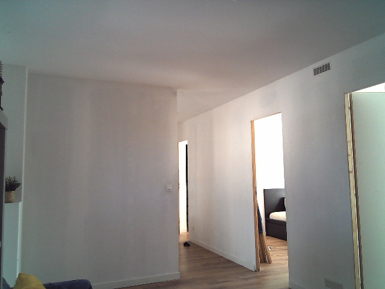
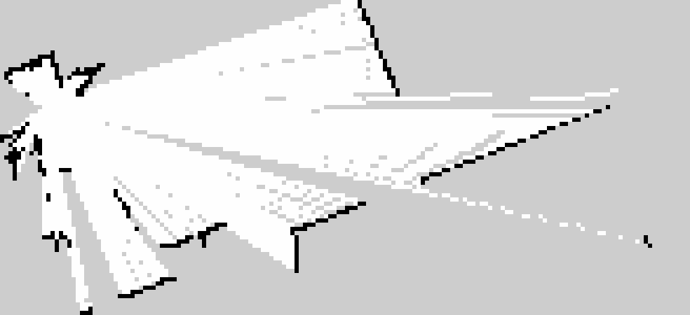
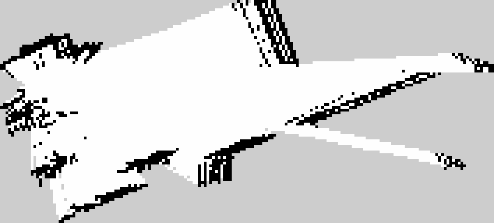

# Tests de cartographie 2D — 2026-11-10

Deux essais de cartographie sur le robot réel, dans un couloir d'appartement : un essai **statique** (robot immobile) et un essai **avec déplacement**. Objectif : valider la chaîne `/scan` → SLAM → `/map` → fichier de carte, et mesurer ce qu'elle produit. Retour à l'[[index]] ; capteur : [[ydlidar_tg30]] ; chaîne cible : [[ros2_nav_stack]].

## 1. Moyens mis en œuvre

| Élément | Valeur |
|---|---|
| SLAM | `slam_toolbox` (nœud `async_slam_toolbox_node`), mode `mapping` |
| Paramètres | `/home/jetson/clawbot/config/slam_toolbox_mapping.yaml` (résolution 0,05 m, portée laser 12 m, `base_frame: base_footprint`, `odom_frame: odom`) |
| Source laser | `/scan`, YDLIDAR TG30, 2 020 points, 10,1 Hz, `BEST_EFFORT` |
| Odométrie | aucune nativement : nœud `scripts/odom_from_vel.py` (intègre `/vel_raw` et le lacet de `/imu/data_raw`, publie `/odom` et TF `odom → base_footprint`) |
| Carte sauvegardée | `ros2 run nav2_map_server map_saver_cli` |
| État du robot | **sur cales, roues en l'air** : aucune translation possible |

Vue de la caméra au moment des essais (robot face au couloir, mobilier proche à gauche) :



Le lidar publie en `BEST_EFFORT` : un abonné en `RELIABLE` ne reçoit rien (erreur constatée au premier essai, cf. [[ydlidar_tg30]] §4). `slam_toolbox` et les scripts de test utilisent donc `qos_profile_sensor_data`.

## 2. Essai 1 — cartographie statique

Robot immobile, TF `odom → base_footprint` statique à l'identité, SLAM lancé 25 s.

| Grandeur | Valeur mesurée |
|---|---|
| Grille | 164 × 75 cellules à 0,05 m (8,20 × 3,75 m) |
| Cellules occupées | 262 |
| Cellules libres | 3 961 |
| Cellules inconnues | 8 077 |
| Emprise des cellules occupées | x 0,00 → 7,70 m ; y 0,00 → 3,70 m |
| Cadence `/map` | 1,0 Hz |
| TF `map → odom` | publiée, identité |
| Fichiers | `maps/test_cartographie_statique.pgm` + `.yaml` (12 314 octets de PGM) |

Une pose unique ne peut pas produire autre chose qu'une coupe du couloir : le résultat prouve que la chaîne fonctionne, pas qu'elle localise.



## 3. Essai 2 — roues en l'air, robot sur cales

**Le robot est monté sur cales, roues en l'air** : il ne translatera pas. Cet essai ne mesure donc pas un déplacement mais la **réponse des roues** à une consigne de vitesse, et l'effet de cette rotation sur la chaîne SLAM.

Consigne publiée sur `/cmd_vel` : `linear.x = 0,12 m/s` pendant 2,0 s, puis `-0,10 m/s` pendant 2,0 s ; l'arrêt de sécurité frontal (±15°, seuil 0,50 m) restait actif mais ne pouvait pas se déclencher sans translation. Distance « parcourue » attendue si les roues tournaient à la vitesse demandée : 0,24 m.

| Grandeur | Valeur mesurée |
|---|---|
| Rotation de roues intégrée, aller | **1,659 m** équivalents (au lieu de 0,24 m) |
| Rotation de roues intégrée, retour | 1,608 m |
| Position finale de l'odométrie | (−0,051 ; +0,003) m |
| Dégagement frontal avant/après | 3,97 m / 3,97 m (aucun obstacle approché) |
| Grille après la séquence | 177 × 80 cellules à 0,05 m (8,85 × 4,00 m) |
| Cellules occupées | **1 010** (contre 262) |
| Cellules libres | **5 500** (contre 3 961) |
| Fichiers | `maps/test_cartographie_apres_deplacement.pgm` + `.yaml` (14 174 octets) |

**La carte obtenue n'est pas une carte du local** : le robot n'ayant pas bougé, les scans successifs sont identiques, alors que l'odométrie annonçait jusqu'à 1,66 m de translation. `slam_toolbox` a donc reçu un prior de mouvement faux et a produit une carte déformée — 748 cellules occupées et 1 539 cellules libres ajoutées sans aucun déplacement réel. Cet essai est conservé comme **démonstration du défaut d'odométrie**, pas comme résultat cartographique.



## 4. Roues : mouvement confirmé, roue par roue

Mesure directe sur la carte, `ros2-driver-node.service` arrêté (port série libre), bibliothèque `Rosmaster_Lib` 3.3.1 :

| Test | Résultat |
|---|---|
| Encodeurs au repos | `(-45 442, -45 323, -38 840, -45 689)` |
| `set_motor(30, 30, 30, 30)` pendant 1,5 s | `(-48 231, -48 207, -41 225, -48 009)` |
| **Delta par roue** | `(-2 789, -2 884, -2 385, -2 320)` — les quatre roues tournent, même sens, dispersion 20 % |
| `set_car_motion(0,10 ; 0 ; 0)` pendant 1,5 s | vitesse rapportée `(-1,287 ; 0,011 ; 0,493)` m/s et rad/s |
| Delta encodeurs pendant la consigne | `(-9 337, -9 530, -7 702, -8 361)` |
| Après arrêt | `(0,0 ; 0,0 ; 0,0)` |

Conclusions factuelles : les quatre motoréducteurs et les quatre encodeurs fonctionnent, aucun câblage n'est coupé ; la rotation est bien renvoyée par les roues. En revanche la commande en boucle fermée produit une vitesse **négative saturée** et une **vitesse angulaire parasite de 0,493 rad/s** alors que `angular.z = 0` était demandé.

## 5. Défaut découvert : boucle de vitesse saturée et signe inversé

Relevé par paliers de 3 s sur `/vel_raw`, moyenne de la seconde moitié de chaque palier :

| Consigne `linear.x` | Vitesse rapportée (moyenne) |
|---|---|
| `+0,05 m/s` | **−0,680 m/s** |
| `+0,10 m/s` | **−0,836 m/s** |
| `+0,20 m/s` | **−0,816 m/s** |
| `−0,10 m/s` | **+0,813 m/s** |

Trois consignes de 0,05 à 0,20 m/s donnent la même vitesse à 3 % près, de signe opposé : ce n'est pas un facteur d'échelle mais une **saturation de la boucle fermée**, cohérente avec une contre-réaction de signe inversé (signe moteur ou encodeur). Les roues tournent donc, et elles le signalent — mais à une vitesse qui ne dépend plus de la consigne.

Conséquence pour les essais : sur cales, aucun risque de collision, mais toute cartographie réelle est impossible, l'odométrie annonçant un mouvement qui n'existe pas. Trace et conditions de clôture : [[ERR-2026-11-10-009_commande_vitesse_non_proportionnelle]].

## 6. Limites de ces essais

- **Robot sur cales, roues en l'air** : aucune cartographie réelle n'est possible ; l'essai 2 mesure la réponse des roues et l'effet d'une odométrie fausse sur le SLAM.
- Aucune mesure de vérité terrain : les distances sont celles de l'intégration de `/vel_raw`, non validées.
- Aucune boucle fermée testée : le robot n'a pas parcouru de trajectoire fermée.
- Qualité métrique de la carte non évaluée (superposition de scans, épaisseur des murs).
- Un seul environnement, un seul capteur, une seule session.
- Le nœud d'odométrie dérive : intégration d'Euler à 10 Hz, sans fusion avec les encodeurs bruts.

## 7. Reproduire

```bash
export ROS_DOMAIN_ID=28 && source /opt/ros/humble/setup.bash
# odométrie (à défaut d'odométrie native)
python3 /home/jetson/clawbot/scripts/odom_from_vel.py &
# SLAM
ros2 run slam_toolbox async_slam_toolbox_node --ros-args \
  --params-file /home/jetson/clawbot/config/slam_toolbox_mapping.yaml &
# sauvegarde
ros2 run nav2_map_server map_saver_cli -f /home/jetson/clawbot/maps/<nom>
```

## 8. Voir aussi

- Lidar et QoS : [[ydlidar_tg30]]
- Nœud de conduite et `/vel_raw` : [[yahboomcar_bringup_driver_node]]
- Chaîne de navigation et prérequis : [[ros2_nav_stack]]
- Défaut de commande de vitesse : [[ERR-2026-11-10-009_commande_vitesse_non_proportionnelle]]
- Modèle et TF : [[modele_urdf_clawbot]]
