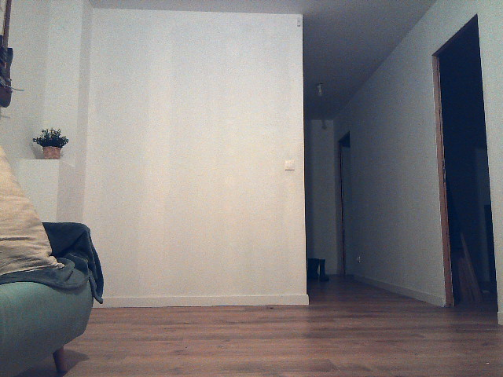
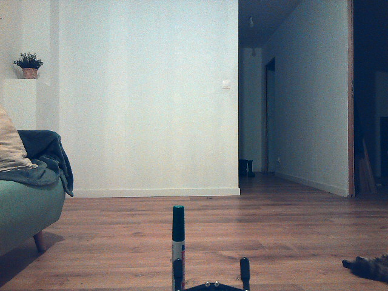
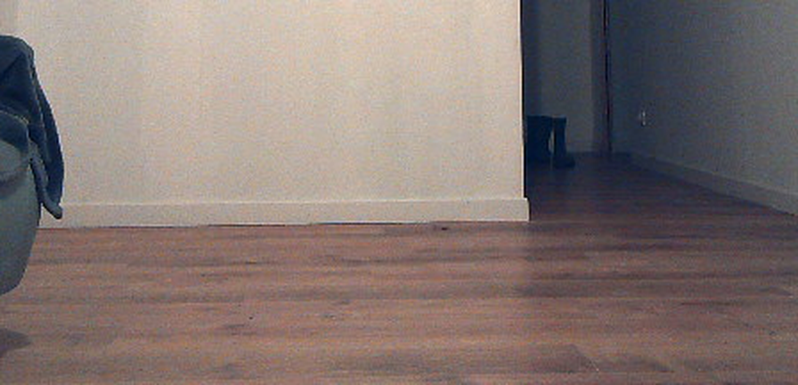
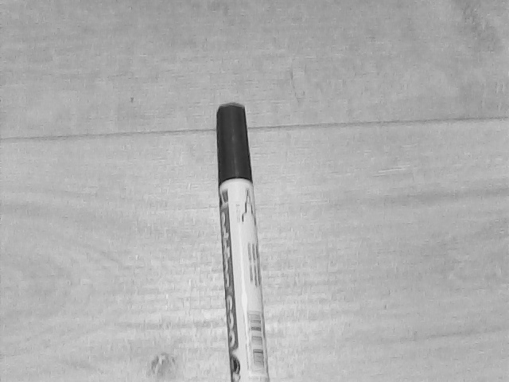
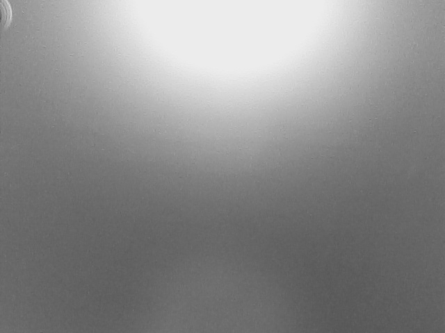

# Essai de préhension d'un stylo — compte rendu

**Objectif** : localiser un stylo posé devant le robot et le saisir avec la pince, en utilisant
MoveIt 2 pour le mouvement du bras et la caméra de profondeur Astra pour la localisation.

**Résultat** : le stylo est localisé, le robot est à portée, MoveIt a planifié et exécuté l'approche
— **la pince est à 9 cm du stylo, doigts ouverts, et la saisie n'a pas été tentée.** Le dernier
segment n'est mesurable par aucun des deux capteurs embarqués à cette distance. Ce compte rendu
existe pour que la méthode puisse être choisie sur des chiffres, pas sur une impression.

Sous-systèmes concernés : [[bras_remise_en_service]], [[manipulation_moveit]],
[[orbbec_astra_pro_plus]], [[camera_poignet]], [[preconditions_mouvement]].

## 1. Configuration mesurée avant l'essai

| Grandeur | Valeur | Où / comment |
|---|---|---|
| Pose de repos du bras | servo `[90, 180, 0, 0, 90, 149]` | `/arm/servo_angles`, validée opérateur le 2026-11-11 19:20 |
| `base_link` au-dessus du sol | **6,4 cm** | plan du sol à z = −0,064 m (voir §3) |
| Astra `camera_link` dans `base_link` | x = −0,044 ; y = 0 ; z = **+0,420** | TF, orientation nulle (horizontale, réglée par l'opérateur) |
| Portée horizontale de la pince | **0,439 m** | `/compute_fk`, 2 205 échantillons de l'espace articulaire |
| Point le plus bas des doigts | **z = −0,115 m** dans `base_link`, soit 5 cm **sous** le sol | idem |
| Limite basse de la profondeur Astra | **1,151 à 1,162 m** | minimum des pixels valides sur 6 trames |
| Pixels de profondeur valides | 85,5 % (262 716 px) | `/camera/depth/image_raw` |
| Bras | `arm_link5` = `arm_joint5`, chaîne `base_link → arm_link1…5` | SRDF `arm` |
| Pince | groupe `gripper`, `open` = −1,54 rad, `closed` = 0 | SRDF, `grip_joint` |
| MoveIt | `pick_ik` 1.1.2, OMPL, `camera_support` modèle le mât | `manipulation_moveit` |

## 2. Chronologie de la tentative

| Heure | Étape | Résultat mesuré |
|---|---|---|
| 19:43:59 | Premier démarrage de `move_group` de la séance | `pick_ik` répond `COLLISION_CHECKING_UNAVAILABLE` (-21) |
| 19:48:42 | Correction TF : l'EKF publie `odom → base_footprint` | arbre unique, 27 cadres |
| 19:49:13 | Redémarrage de `clawbot-move-group` | `/compute_ik` → **SUCCESS** sur la pose courante |
| ~19:52 | Mesure du sol (1re méthode, fausse) | z = **−0,414 m** → conclusion « les doigts s'arrêtent 30 cm au-dessus du sol » |
| ~19:55 | Mesure du sol (histogramme des z) | z = **−0,064 m** → conclusion inversée : les doigts passent 5 cm sous le sol |
| ~19:57 | Localisation du stylo | Astra, stylo debout sur support, pixels (298, 371)-(298, 445) |
| ~19:58 | Avancée du robot, boucle fermée sur `/odom` | **15,6 cm** en 6,1 s à 0,04 m/s |
| ~20:00 | Ouverture de la pince | servo 6 : **149 → 2** (q = −1,54 rad) |
| ~20:01 | Planification et exécution MoveIt de la pose d'approche | 163 points, 16,2 s, **SUCCESS** |
| ~20:03 | Lecture de la caméra du poignet en pose d'approche | image sans structure, arrêt de la tentative |

## 3. Preuves brutes

### 3.1 Le sol, mesuré deux fois, deux valeurs

Première méthode — percentile des z dans la bande basse de l'image :

```text
seuil = 25e centile des z des points de la bande basse
plan du sol mesure  : z = -0.414 m          <-- FAUX
```

Seconde méthode — pic de l'histogramme des z sur toute l'image :

```text
points valides : 262716 (85.5 %)
z dans base_link : min -0.123  median +0.442  max +2.049
pic d'histogramme des z : -0.065 m (21 % des points)
plan retenu : z = -0.064 m sur 33120 points, etendue en x +1.10 a +5.41 m
```

Le pic couvre 33 120 points de x = 1,10 à 5,41 m : c'est bien le sol. La première méthode
sélectionnait le châssis et des points aberrants. **Toute la conclusion de portée en dépendait.**

### 3.2 Portée du bras, par la cinématique directe de MoveIt

```text
echantillons acceptes : 2205
z minimal de arm_link5 : -0.115 m   (j2,j3,j4 = (1.57, 1.57, 0.0), x = +0.017)
z minimal devant (x>0,15) : -0.115 m  (x = +0.184)
x maximal de arm_link5 : +0.439 m   (j2,j3,j4 = (-1.57, 0.0, 0.0), z = +0.145)
```

Avec le doigt `rlink1`/`llink1` inclus dans le FK, le minimum reste −0,115 m : c'est `arm_link5`
qui contraint, les doigts ne descendent pas plus bas dans les poses accessibles.

### 3.3 Le stylo dans l'Astra, et la limite du capteur

```text
fenetre centrale : plus proche 1.493 m, mediane 2.455 m
pixel (298,425) : 144 px valides, min 1.539 m, mediane 1.596 m   <- le sol DERRIERE le stylo
pixel (298,445) : 144 px valides, min 1.396 m, mediane 1.434 m
profondeur globale : min 1.151 m
```

Le stylo est plus près que la limite basse du capteur : la profondeur ne le voit pas, elle rend le
fond. **L'Astra ne peut pas mesurer un objet à moins de ~1,15 m.**

Carte de profondeur (médiane par case, `----` = aucune mesure), après l'avancée :

```text
           0    40    80   120   160   200   240   280   320   360   400   440   480   520   560   600
v=  0   3.30  3.43  3.60  3.57  3.50  3.46  3.43  3.39  3.33  3.30  ----  ----  ----  ----  ----  ----
v= 40   3.33  3.39  3.57  3.53  3.46  3.43  3.43  3.36  3.30  3.27  5.49  4.74  3.89  3.30  2.93  ----
v= 80   3.20  3.33  3.53  3.50  3.46  3.43  3.39  3.33  3.30  3.23  5.67  4.74  3.89  3.27  2.93  4.17
v=120   3.06  3.17  3.57  3.57  3.53  3.50  3.46  3.36  3.30  3.23  5.67  4.74  3.84  3.23  2.91  4.12
v=160   3.04  3.12  3.57  3.53  3.53  3.46  3.46  3.43  3.36  3.27  5.67  4.67  3.84  3.23  2.88  4.12
v=200   1.49  1.80  3.53  3.53  3.50  3.46  3.46  3.43  3.36  3.27  5.67  4.74  3.89  3.27  2.91  4.17
v=240   1.43  1.75  1.80  3.53  3.50  3.46  3.43  3.43  3.33  3.27  5.58  4.71  3.84  3.23  2.88  3.01
v=280   1.27  1.42  1.72  3.53  3.50  3.46  3.43  3.39  3.33  3.23  ----  4.49  3.76  3.22  2.91  3.04
v=320   1.22  1.43  1.71  3.06  3.06  3.27  3.06  3.06  3.12  2.86  2.75  2.54  2.47  2.62  2.65  ----
v=360   1.24  1.54  2.14  2.16  2.15  2.12  2.14  2.11  2.05  2.06  2.04  2.01  1.98  1.97  1.95  1.90
v=400   1.61  1.68  1.68  1.67  1.67  1.65  1.67  1.63  1.62  1.60  1.59  1.57  1.57  1.55  1.54  1.51
v=440   1.37  1.37  1.37  1.35  1.35  1.35  1.35  1.33  1.32  1.32  1.31  1.30  1.29  1.28  1.27  1.27
```

Lecture : les lignes v ≥ 360 sont le sol ; la colonne de gauche à 1,2-1,8 m est le fauteuil ; rien
ne marque le stylo ni son support, faute de résolution à cette distance et de mesure en dessous de
1,15 m.

### 3.4 Avancée du robot

```text
depart : x=+0.000 y=+0.000   consigne 0.04 m/s sur 15 cm
arrivee : x=+0.156 y=-0.007   parcouru 15.6 cm en 6.1 s (cible atteinte)
```

### 3.5 Ouverture de la pince

```text
consigne grip_set position = -1.54 rad  -> ACCEPTED
/arm/servo_angles -> [90, 180, 0, 0, 90, 2]      (servo 6 : 149 -> 2)
```

### 3.6 Planification et exécution MoveIt (pose d'approche)

```text
cible : arm_joint1..5 = [0.0, -1.0, -0.8, 1.57, 0.0]
points de trajectoire : 163 sur 16.2 s
  t= 0.00s  [+0.00, +1.57, -1.57, -1.57, +0.00]
  t= 8.10s  [+0.00, +0.28, -1.19, -0.00, -0.00]
  t=16.19s  [+0.01, -1.00, -0.81, +1.57, -0.00]
execution demandee…
execution : SUCCESS
/arm/servo_angles -> [90, 33, 42, 173, 90, 2]
```

Pose atteinte, lue en TF :

```text
arm_link5  x=+0.287 y=-0.001 z=+0.339
rlink1     x=+0.268 y=-0.014 z=+0.274
llink1     x=+0.268 y=+0.011 z=+0.274
```

### 3.7 Configuration de saisie calculée, jamais exécutée

Recherche par FK sur 1 125 configurations (`scripts/cherche_pose.py 0.36 0.0 0.30`) :

```text
  dist   j2     j3     j4     -> x      y      z
  0.006  -0.40  -1.40  +0.79  -> +0.358 +0.000 +0.294
  0.013  -1.40  +1.00  -0.79  -> +0.373 +0.000 +0.301
  0.014  -0.60  +0.00  -0.79  -> +0.363 +0.000 +0.314
```

La meilleure place la pince à **6 mm** de la cible. La distance entre les doigts et le stylo est de
**9 cm** en x.

### 3.8 Les deux caméras à 40 cm de l'objet

| Image | Moyenne | Écart-type | Netteté (var. Laplacien) | Pixels à 255 |
|---|---|---|---|---|
| Astra, avant avancée | 129,6 | 60,4 | 603,7 | 0 % |
| Astra, après avancée | 130,5 | 62,9 | 648,7 | 0 % |
| Poignet, à `servo 2 = 120` (le stylo était visible) | 177,1 | 20,4 | 171,7 | 0 % |
| **Poignet, en pose d'approche** | **138,8** | **44,8** | **16,9** | 0 % |



*Figure 1 — l'Astra avant l'avancée. Le stylo est le trait vertical clair au centre bas.*



*Figure 2 — après 15,6 cm. Le stylo descend dans l'image et sort par le bas : il est plus près.*



*Figure 3 — bas de l'image Astra agrandi ×2 : le stylo et le parquet.*



*Figure 4 — caméra du poignet à `servo 2 = 120` : le stylo est identifiable, netteté 171,7.*



*Figure 5 — caméra du poignet en pose d'approche : aucune structure, netteté 16,9. Le cadre optique
de l'URDF est mal orienté (+90° de tangage mesuré le 2026-11-11 19:45), la caméra ne vise pas la zone
de saisie.*

## 4. Hypothèses éliminées

| Hypothèse | Test qui l'élimine | Verdict |
|---|---|---|
| « Le bras ne peut pas atteindre le sol » | plan du sol par histogramme : −0,064 m ; doigts à −0,115 m | **éliminée** — les doigts passent 5 cm sous le sol |
| « Le stylo est hors de portée en distance » | avancée de 15,6 cm puis position estimée ~0,36 m < 0,439 m | **éliminée** |
| « L'Astra peut localiser le stylo à cette distance » | profondeur au pixel du stylo : 1,539 m (le fond) ; minimum global 1,151 m | **éliminée** — l'objet est sous la limite basse du capteur |
| « La caméra du poignet peut guider les 9 derniers centimètres » | image d'approche : écart-type 44,8 mais netteté 16,9, aucune structure reconnaissable | **éliminée en l'état** — le cadre optique est mal déclaré, l'objectif ne vise pas la pince |
| « MoveIt est utilisable » | `/compute_ik` → SUCCESS après correction du double parent TF | **résolue** le 2026-11-11 19:48 (voir [[manipulation_moveit]] §5) |
| « Le stylo est sur le sol » | l'opérateur indique un support de 29 cm ; la position verticale n'a pas été mesurée indépendamment | **non vérifiée par la mesure** — à confirmer |

## 5. Ce qui bloque, classé par coût

| # | Piste | Coût | Ce qu'elle apporte | Ce qu'elle ne règle pas |
|---|---|---|---|---|
| 1 | L'opérateur confirme visuellement l'encadrement du stylo, puis exécution de la configuration `j2=−0,40, j3=−1,40, j4=+0,79` et fermeture | ~2 min, aucun code | une saisie réelle, si l'alignement est bon | pas de boucle fermée : aucune répétabilité, aucun contrôle de l'erreur |
| 2 | Corriger le cadre optique du poignet dans l'URDF (+90° en tangage) et ses intrinsèques (`fx≈2300 px`, pas 457) | ~1 h, modification d'URDF + rebuild + tests | la caméra du poignet redevient utilisable comme capteur d'asservissement à 40 cm | ne donne pas la distance : il faut un asservissement visuel en pixels |
| 3 | Approcher en deux temps : mesurer le stylo à 1,2-1,5 m quand la profondeur Astra est valide, avancer en boucle fermée, puis finir les 30 derniers centimètres à l'aveugle sur la dernière mesure | ~2 h | garde une mesure métrique jusqu'à 1,2 m | l'erreur des 30 derniers centimètres reste entière |
| 4 | Rendre la cible mesurable : marqueur de taille connue à côté du stylo, ou surface plane de référence sur le support | ~30 min | une échelle dans l'image, donc une distance sans profondeur | dépend d'une mise en place manuelle |
| 5 | Capteur dédié courte portée sur la pince (ultrason, ToF, ou la caméra du poignet correctement calibrée sur mire) | achat / calibration | la mesure manquante à 10-40 cm | hors du matériel actuel |

## 6. État laissé sur le poste

| Élément | État |
|---|---|
| Bras | `[90, 33, 42, 173, 90, 2]` — **pose d'approche**, pince ouverte, `arm_folded: False` |
| `arm_link5` | x = +0,287 ; y = −0,001 ; z = +0,339 |
| Stylo | **non touché** (la saisie n'a pas été tentée), position non revérifiée après l'arrêt |
| Robot (base) | avancé de 15,6 cm depuis l'origine de la séance |
| Services | `ros2-driver-node`, `clawbot-ekf`, `clawbot-safety-arbitrator`, `clawbot-arm-controller`, `clawbot-director`, `clawbot-move-group` : **6 actifs** |
| MoveIt | actif, `planning_frame = base_link`, `camera_support` publié |
| Caméra du poignet | `gain = 0`, `brightness = 0` en service ; l'unité pose encore 60/70 (volatile) |
| Astra | horizontale, réglée par l'opérateur ; le modèle la décrit ainsi (rotation nulle) |

**Retour à la pose de repos validée** — à faire avant tout déplacement de la base :

```bash
export ROS_DOMAIN_ID=28 && source /opt/ros/humble/setup.bash
cd /home/jetson/clawbot
python3 scripts/moveit_plan.py 0,1.5708,-1.5708,-1.5708,0 --executer
echo '{"op":"start_skill","skill":"grip_set","args":{"position":-0.265,"duration_s":2.0}}' \
  | python3 -m bridge_mcp.director_client      # pince à servo 149, comme au repos mesuré
python3 scripts/etat_directeur.py | egrep 'arm_angles|arm_folded'
```

## 7. Reproduire l'essai

Scripts ajoutés au dépôt par cette séance (`/home/jetson/clawbot/scripts/`) :

| Script | Rôle |
|---|---|
| `plan_sol.py` | hauteur du sol dans `base_link` par histogramme des z de la profondeur |
| `astra_duo.py` | capture Astra couleur + profondeur ; position 3D d'un pixel en `base_link` |
| `avance_cm.py` | avancée en boucle fermée sur `/odom`, consigne sur `/cmd_vel` |
| `moveit_plan.py` | planification et exécution MoveIt vers des angles articulaires ou une position |
| `cherche_pose.py` | configuration du bras la plus proche d'un point, par FK sur tout l'espace |
| `enveloppe_pince.py` | enveloppe atteignable de la pince par `/compute_fk` |

```bash
export ROS_DOMAIN_ID=28 && source /opt/ros/humble/setup.bash
source /home/jetson/clawbot/install/setup.bash
python3 scripts/plan_sol.py                       # sol a z = -0.064 m
python3 scripts/astra_duo.py 298 425              # profondeur et position du pixel du stylo
python3 scripts/avance_cm.py 0.15 0.04            # avance de 15 cm
python3 scripts/moveit_plan.py 0,-1.00,-0.80,1.57,0 --executer
python3 scripts/cherche_pose.py 0.36 0.0 0.30     # configuration de saisie a 6 mm
```

## 8. Voir aussi

- [[index]]
- [[bras_remise_en_service]]
- [[manipulation_moveit]]
- [[orbbec_astra_pro_plus]]
- [[camera_poignet]]
- [[preconditions_mouvement]]
- [[navigation_nav2_waypoints]]
