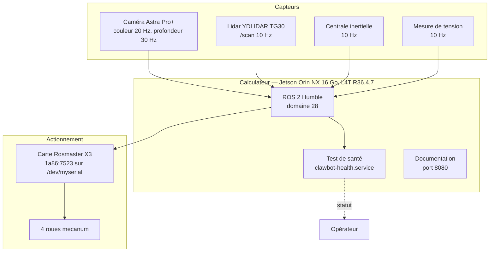

# Robot Clawbot X3 — architecture

Robot mobile autonome à roues mecanum : plateforme **Jetson Orin NX**, middleware **ROS 2 Humble**
sur le domaine 28, caméra RGB-D Orbbec Astra Pro+, carte de commande Rosmaster X3 en liaison série.

## Par où commencer

| Je cherche… | Aller à |
|---|---|
| La fiche matérielle d'un composant | [Matériel](#materiel) |
| Les nœuds ROS 2 et leurs topics | [[ros2_graph_clawbot]] |
| L'état courant des nœuds et services | [[etat_noeuds_et_services]] |
| Ce qui est installé et à quelle version | [[bom_logiciel]] |
| Les pannes et anomalies ouvertes | [Traces d'erreurs](#erreurs) |
| Le pont LLM vers ROS 2 | [Section Bridge](../bridge/index.md) |

## Matériel { #materiel }

| Composant | Identité constatée | Fiche |
|---|---|---|
| Calculateur | Jetson Orin NX 16 Go, Ubuntu 22.04.5, noyau `5.15.148-tegra`, L4T R36.4.7 | [[jetson_orin_nx]] |
| Carte de commande | Rosmaster X3, CH340 `1a86:7523`, `/dev/myserial` → `ttyUSB1`, 115 200 Bd | [[rosmaster_x3_mcu]] |
| Caméra | Orbbec Astra Pro+, fonctions USB `0c45:6340` (UVC) et `2bc5:060f` (profondeur) | [[orbbec_astra_pro_plus]] |
| Alimentation | Batterie principale, tension seule (aucune jauge d'énergie) | [[batterie_principale]] |
| Lidar | YDLIDAR TG30, CP2102 `10c4:ea60`, `/dev/ydlidar`, 512 000 Bd, `/scan` 10 Hz | [[ERR-2026-11-10-001_absence_topic_scan]] |

## Logiciel embarqué

| Sujet | Page | Repère |
|---|---|---|
| Graphe ROS 2 constaté | [[ros2_graph_clawbot]] | 7 nœuds, 26 topics |
| Nœud de conduite | [[yahboomcar_bringup_driver_node]] | `/driver_node` : `cmd_vel` → série |
| Chaîne de navigation | [[ros2_nav_stack]] | installée, non déployée |
| Unités systemd | [[systemd_robot_services]] | 9 unités dont 8 actives |
| État à l'instant | [[etat_noeuds_et_services]] | relevé généré |

## Erreurs et anomalies { #erreurs }

| Trace | Sujet | Statut |
|---|---|---|
| [[ERR-2026-11-10-001_absence_topic_scan]] | `/scan` absent — lidar présent, pilote non lancé | clos |
| [[ERR-2026-11-10-002_espace_disque_critique]] | partition racine à 92 % | ouvert |
| [[ERR-2026-11-10-003_arbre_tf_incomplet]] | `base_link`, `odom`, `map` absents | ouvert |
| [[ERR-2026-11-10-004_execution_de_commande_non_authentifiee]] | injection de commande via `Speak` | ouvert |
| [[ERR-2026-11-10-005_pytest_plugins_launch_testing]] | pytest cassé dans un shell ROS | contourné |

## Ce que ce robot ne fait pas

- **Pas de navigation autonome** : le lidar fonctionne (`/scan` à 10 Hz) mais les cadres TF `map` et
  `odom` sont absents, `base_link` n'existe pas, et la pile `nav2` n'est pas déployée.
- **Pas de jauge d'énergie** : seule la tension est mesurée (11,9 V au dernier relevé).
- **Pas de manette branchée** : le service de téléopération tourne, aucun périphérique d'entrée
  n'est présent (constaté par le test de santé).
