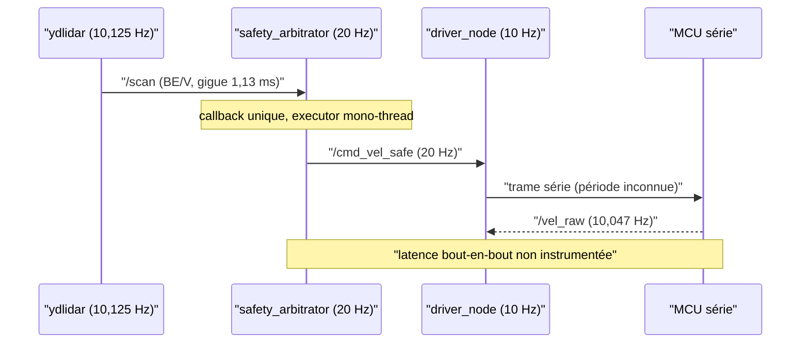

# Analyse dynamique, flux critiques et goulots — Clawbot X3

## 1. Méthode de mesure

- **Fenêtre :** 2026-11-22 entre 10:59:33 et 11:08:10 (CET), robot en fonctionnement nominal, au repos (aucune commande de mouvement envoyée) [S20].
- **Cadences :** `ros2 topic hz` sur 7 s pour 39 topics [S08], puis 7 à 12 s sur les flux écartés de la boucle (images, `/scan`, `/point_cloud`, `/map`) [S09]. La sortie donne une **moyenne**, un **min/max d'inter-arrivée** et un **écart-type** : c'est cette valeur qui est reportée comme gigue, jamais une estimation.
- **Ressources :** `ps` (moyenne CPU par processus depuis le démarrage, RSS) [S12], `tegrastats` à 1 Hz pendant 6 s (RAM, puissance, températures, `GR3D_FREQ`, fréquences CPU) [S16], `df` pour `/dev/shm` [S13].
- **Réseau et IPC :** `ss -uan` (sockets RTPS) [S14], `ip -s link` [S15].
- **Ce que la méthode ne mesure pas :**
  - **Latence bout-en-bout** (capteur → actionneur) : aucun message ne porte d'horodatage comparable. `[NON OBSERVÉ / À VÉRIFIER]` → obtenir : `ros2 topic delay <topic>` sur les topics dont l'émetteur renseigne `header.stamp` (aucun émetteur maison ne le fait aujourd'hui : [S30]), ou instrumentation `ros2_tracing` (installation hors périmètre).
  - **Pertes de messages** : `ros2 topic hz` ne compte pas les trous au-delà de la fenêtre affichée. `[NON OBSERVÉ / À VÉRIFIER]` → obtenir : abonné de comptage dédié, ou `ros2 topic bw` comparé au débit théorique.
  - **Ventilation CPU par callback** : `ps` agrège par processus. `[NON OBSERVÉ / À VÉRIFIER]` → obtenir : `py-spy dump --pid <pid>` (outil absent) ou `perf record` en préfixe de lancement.
  - **Comportement sous charge** : le robot n'a pas été sollicité (aucune consigne). Les chiffres ci-dessous décrivent un système **au repos** ; ils sont un plancher, pas un profil de mission.

## 2. Chaînes causales critiques

### 2.1 Perception lidar → arbitrage → châssis

| # | Étape | Nœud | Entrée | Sortie | Fréquence mesurée | Latence | Gigue (écart-type) | Source |
|---|---|---|---|---|---|---|---|---|
| 1 | Acquisition | `ydlidar_ros2_driver_node` | USB | `/scan` | 10,125 Hz | `[NON OBSERVÉ / À VÉRIFIER]` → obtenir : `ros2 topic delay /scan` (pas de `header` exploitable côté driver) | 1,13 ms (min 95 ms / max 102 ms) | [S09] |
| 2 | Arbitrage | `safety_arbitrator` | `/scan`, `/cmd_vel`, `/imu/data_raw`, `/voltage`, `/arm/servo_angles` | `/cmd_vel_safe`, `/safety/state`, `/safety/hold` | 20,001 Hz en sortie | `[NON OBSERVÉ / À VÉRIFIER]` → obtenir : horodatage d'entrée/sortie dans le même callback, puis `ros2 topic delay` | 0,00 ms sur `/safety/state` (20,000 Hz) | [S08] |
| 3 | Commande | `driver_node` | `/cmd_vel_safe` | `/vel_raw` | 10,047 Hz | `[NON OBSERVÉ / À VÉRIFIER]` → obtenir : mesure sur `/vel_raw` contre consigne, protocole `tests-materiel` §1 | non mesurée | [S08] |
| 4 | Actionneur | MCU série (`Rosmaster_Lib` 3.3.9) | trame série | mouvement | `[NON OBSERVÉ / À VÉRIFIER]` → obtenir : arrêt du pilote + lecture directe de la carte | — | — | [S25] |

Le maillon 2 est le seul à publier à 20 Hz alors que son entrée principale (`/cmd_vel`) est muette au repos : la chaîne complète n'a donc **pas été exercée** pendant la collecte. Les temps de traversée 1→4 restent inconnus.

### 2.2 Perception caméra → détection → décision

| # | Étape | Nœud | Entrée | Sortie | Fréquence mesurée | État |
|---|---|---|---|---|---|---|
| 1 | Acquisition poignet | `wrist_camera/camera` (v4l2) | V4L2 `/dev/v4l/by-id/usb-Sonix_…` | `/wrist_camera/image_raw` | 30 Hz (std dev 2,09 ms) | opérationnel [S09], [S25] |
| 2 | Source YOLO | `yolo_source_camera` | `/wrist_camera/image_raw` | **aucune publication** | — | nœud actif, 0 éditeur [S02] |
| 3 | Inférence | `yolo_service.py` (HTTP 8003) | image HTTP | JSON HTTP | `[NON OBSERVÉ / À VÉRIFIER]` → obtenir : `curl -s localhost:8003/health` et chronométrage | hors graphe [S25] |
| 4 | Publication | `/detections`, `/camera/detection_image` | — | — | **aucun éditeur** | chaîne rompue [S07] |
| 5 | Consommation | `sentinel` (profondeur), `hardware_service_node` (`/detections`) | — | — | abonnés orphelins | [S02] |

**La chaîne de détection n'existe pas dans le graphe.** Deux abonnés attendent des messages qui n'ont aucun émetteur [S07]. L'inférence se fait donc uniquement par HTTP, et le résultat n'est jamais republié dans ROS 2.

### 2.3 Profondeur → sentinel

| # | Étape | Constat |
|---|---|---|
| 1 | `astra_camera` publie `/camera/depth/image_raw` et `/camera/depth/points` (1 éditeur chacun) [S07] | — |
| 2 | **Aucun message en 12 s** sur les deux topics [S09] | la couleur, elle, sort à 30,004 Hz [S09] |
| 3 | `sentinel` est abonné à `/camera/depth/image_raw` [S02] | il ne reçoit rien |
| 4 | Coût | `astra_camera` consomme **57,2 % de CPU** et 137 Mo de RSS [S12] pour un flux profondeur muet |

Cette chaîne est **rompue à la source**, et c'est le premier poste de consommation CPU du poste.

### 2.4 Bras : objectif → trajectoire → servos

| # | Étape | Nœud | État observé |
|---|---|---|---|
| 1 | Décision | `director` | actif, `/director/state` à 4,999 Hz [S08] |
| 2 | Serveur de trajectoire | `clawbot_arm_controller` | **absent du graphe** (unité non active) [S01], [S25] |
| 3 | Planification | `move_group` | **absent** : `ros2 action list -t` ne renvoie rien [S05] |
| 4 | Relecture | `/arm/servo_angles` | 10,016 Hz, seul flux du bras disponible [S08] |

Le directeur peut donc lire la position du bras et la publier, mais **ne peut pas planifier ni exécuter** : son `client_action` échouera en `action indisponible` sur toute étape de bras (branche visible dans le code, [S30]). Latence et gigue du bras : `[NON OBSERVÉ / À VÉRIFIER]` → obtenir : activer `clawbot-arm-controller`, puis mesurer `/arm/joint_states` (aujourd'hui sans éditeur, [S07]).

### 2.5 Navigation

Aucun nœud Nav2 n'est actif, `clawbot-nav2.service` n'apparaît pas dans les services en cours [S25], et `/map` ne publie aucun message en 12 s [S09] alors que `slam_toolbox` tourne en mode `mapping`. La chaîne navigation → `cmd_vel` n'existe pas à l'instant de la collecte.

## 3. Executors et groupes de callback

| Nœud | Executor | Threads | Groupes de callback | Timers déclarés | Subscriptions | Source |
|---|---|---|---|---|---|---|
| `director` | `rclpy.spin(node)` → **SingleThreadedExecutor implicite** | 1 | aucun groupe déclaré (tous mutuellement exclusifs par défaut) | `STATE_PERIOD_S = 0.2` (5 Hz), `WATCHDOG_PERIOD_S = 0.1` (10 Hz) | 2 (`/arm/servo_angles`, `/safety/state`) + service `/director/command` | [S28], [S02] |
| `safety_arbitrator` | `rclpy.spin` → **SingleThreaded** | 1 | aucun | `create_timer(0.05, self.tick)` (20 Hz) | 5 | [S28], [S02] |
| `sentinel` | `rclpy.spin` → **SingleThreaded** | 1 | aucun | `PERIODE_APPLICATION_S = 0.5` (2 Hz), sonde 1,0 s | 3 | [S28], [S02] |
| `hardware_service_node` | `rclpy.spin(ros_node)` dans un `threading.Thread` démon | 1 (ROS) + 1 (watchdog) | aucun | non déclaré dans le fichier | 6 | [S02], [S30] |
| `driver_node` (vendor) | non observé dans le code déployé | — | — | — | 4 | [S02] |
| `arm_trajectory_server` (non actif) | `MultiThreadedExecutor(num_threads=4)` | 4 | `ReentrantCallbackGroup` pour l'action | timer de publication des joints | — | [S28] |
| `api_server` (C++, 8000) | `MultiThreadedExecutor(num_threads=4)` dans un thread dédié | 4 | — | — | 1 (`/cmd_vel`) | [S28], [S02] |
| `yolo_service` (hors graphe) | FastAPI/uvicorn | — | — | — | nœud `yolo_source_camera` : 0 éditeur, 1 abonné | [S02] |

Trois constats mesurables :

1. **Les quatre nœuds qui portent la décision et la sécurité sérialisent tous leurs callbacks.** `safety_arbitrator` reçoit environ 50 messages par seconde (5 abonnements à 10-20 Hz) et publie 3 topics à 20 Hz sur un seul thread [S02], [S08]. Toute attente dans un callback retarde l'arbitrage, donc la chaîne d'arrêt.
2. **Aucune priorité ni affinité CPU n'est configurée** : 0 occurrence de `Nice=`, `CPUSchedulingPolicy=`, `CPUAffinity=` dans les 14 unités inspectées [S25]. Le noyau arbitre librement, et `astra_camera` à 57,2 % de CPU concourt avec `safety_arbitrator` (14,4 %) et `director` (6,7 %) [S12].
3. **Aucun groupe réentrant dans les nœuds actifs** : la réentrance n'existe que dans le serveur de bras, qui ne tourne pas [S28]. Le système est donc intégralement séquentiel par nœud, avec un seul parallélisme réel : les threads du serveur API et les processus distincts.

**Précision sur les appels `.result()` :** le grep de code relève trois appels dans les nœuds actifs (`director_node.py:229`, `director_node.py:298`, `sentinel_node.py:178`) [S33]. Lecture faite, les trois sont **à l'intérieur de `add_done_callback`**, donc sur un futur déjà résolu : ce ne sont pas des appels bloquants. Les signaler comme tels sans lire le contexte aurait été un faux positif.

## 4. Subscriptions et traitements bloquants

| Fichier:ligne | Motif détecté | Nœud | Effet établi | Source |
|---|---|---|---|---|
| `clawbot_arm_controller/arm_trajectory_server.py:254` | `time.sleep(remaining)` | serveur de bras | bloque un thread du `MultiThreadedExecutor(4)`, pas les autres | [S33], [S28] |
| `clawbot_arm_controller/arm_trajectory_server.py:328` | `time.sleep(self.servo_stagger_s)` | serveur de bras | cadence volontaire entre servos, bloquant par construction | [S33] |
| `ros2_llm_bridge/hardware_service.py:192` | `time.sleep(0.3)` | service matériel | exécuté dans un thread d'initialisation, hors boucle ROS | [S33] |
| `ros2_llm_bridge/hardware_service.py:563,601,616,630` | `subprocess.check_output`, `pkill -9 -f` | service matériel | pilotage de processus par motif : tue aussi le shell appelant si le motif matche sa ligne de commande | [S33] |
| `clawbot_director/director_node.py:229,298` | `.result()` | directeur | dans un `done_callback` : non bloquant (vérifié au §3) | [S33] |
| `clawbot_sentinel/sentinel_node.py:178` | `.result()` | sentinel | idem, dans un `done_callback` | [S33] |
| `clawbot_moveit_config/tools/*.py` | `spin_once`, `time.sleep(1.0)` | outils hors service | scripts d'essai, hors chemin d'exécution | [S33] |

Aucun appel bloquant n'a été trouvé **dans un callback de nœud actif à executor mono-thread**. Le risque de famine vient donc du volume et de l'ordonnancement (§3), pas d'un blocage explicite.

## 5. Ressources

### 5.1 CPU par processus (moyenne depuis le démarrage)

| Processus | %CPU | RSS | Remarque | Source |
|---|---|---|---|---|
| `astra_camera_node` | **57,2** | 137 Mo | couleur à 30 Hz, **profondeur muette** | [S12], [S09] |
| `clawbot_safety.arbitrator` | 14,4 | 63 Mo | 20 Hz de sortie, 50 msg/s en entrée | [S12] |
| `Mcnamu_driver_X3` | 13,7 | 58 Mo | série MCU à 10 Hz | [S12] |
| `yolo_service.py` (`pt_main_thread`) | 10,3 | **1 498 Mo** | inférence sur CPU, GPU à 0 % | [S12], [S16] |
| `rosbridge_websocket` | 9,9 | 66 Mo | passerelle WebSocket | [S12] |
| `yahboom_oled.pyc` | 9,0 | 19 Mo | afficheur OLED, sans `Restart` | [S12], [S25] |
| `clawbot_director` | 6,7 | 60 Mo | 5 Hz d'état | [S12] |
| `hardware_service.py` | 5,8 | 98 Mo | HTTP 8001 + 6 abonnements | [S12] |
| `ydlidar_ros2_driver_node` | 5,8 | 23 Mo | 10 Hz | [S12] |
| `joint_state_publisher` | 4,4 | 53 Mo | 20 Hz | [S12] |
| `clawbot_sentinel` | 3,2 | 66 Mo | 2 Hz | [S12] |
| `ekf_filter_node` | 3,0 | 30 Mo | 63 paramètres, 5 sorties | [S12] |
| `async_slam_toolbox_node` | 2,2 | 40 Mo | mode `mapping`, robot immobile | [S12] |

Total ≈ **143 %** d'un cœur, sur 8 cœurs disponibles [S12]. Le processus le plus coûteux est celui dont la sortie principale est muette.

### 5.2 Mémoire, accélérateur, énergie, thermique

| Grandeur | Valeur | Source |
|---|---|---|
| RAM | 7 092 / 15 656 Mo (45 %) | [S16] |
| Swap | 10 / 16 020 Mo | [S16] |
| RSS cumulé des processus ROS et HTTP | ≈ 2,2 Go, dont 1,5 Go pour `yolo_service` | [S12] |
| `GR3D_FREQ` (GPU) | **0 %** sur les 6 échantillons | [S16] |
| Fréquence CPU | 729 ou 1 190 MHz (deux paliers observés) | [S16] |
| Températures | `cpu` 53,4-53,5 °C, `tj` idem, `gpu` 50,6-50,9 °C, `soc0` 48,2-48,3 °C | [S16] |
| Puissance d'entrée | `VDD_IN` 6 090 mW constants | [S16] |

### 5.3 Réseau et IPC

| Grandeur | Valeur | Source |
|---|---|---|
| Sockets UDP RTPS | 6 en écoute : 7400, 7412, 7413, 7414, 7415 | [S14] |
| Interface montée | `wlP1p1s0` (Wi-Fi), état `DORMANT` ; `eno1` sans porteuse | [S15] |
| `/dev/shm` | 12 Mo / 7,7 Go : aucun segment partagé notable | [S13] |
| Ports HTTP | 8000 (API C++), 8001 (matériel), 8003 (YOLO), 8080 (docs) | [S25] |
| Disque | 84 % occupé | [S13] |

**Lecture :** tout le trafic DDS passe par UDP sur le Wi-Fi, y compris les images brutes de la caméra du poignet (30 Hz) et le nuage de points (10 Hz) [S07], [S15]. Aucun transport partagé, aucune composition : la boucle image → nœud → nœud traverse la pile réseau à chaque message.

## 6. Diagnostic priorisé

| # | Symptôme observé | Preuve | Cause établie / hypothèse | Criticité | Axe d'amélioration | Source |
|---|---|---|---|---|---|---|
| 1 | Flux de profondeur muet alors que le nœud qui le produit consomme 57 % du CPU | 0 message en 12 s sur `/camera/depth/image_raw` et `/camera/depth/points` ; 57,2 % CPU | établie : le flux n'est pas produit | **Haute** | soit réparer la profondeur (USB, résolution, `depth_fps`), soit éteindre la publication profondeur ; instrumenter en amont | [S09], [S12] |
| 2 | Chaîne de détection absente du graphe | `/detections` et `/camera/detection_image` sans éditeur ; `yolo_source_camera` 0 éditeur | établie : l'inférence vit en HTTP, hors ROS | **Haute** | republier le résultat d'inférence dans ROS 2, ou assumer l'architecture et supprimer les abonnés orphelins | [S07], [S02] |
| 3 | Bras non commandable | `ros2 action list` vide, `clawbot-arm-controller` non actif, `/arm/joint_states` sans éditeur | établie : unités arrêtées | **Haute** | activer et superviser les unités ; sinon le directeur ne peut exécuter aucune étape de bras | [S05], [S25], [S07] |
| 4 | Sérialisation de l'arbitrage de sécurité | 1 thread, 50 msg/s en entrée, 3 topics à 20 Hz en sortie | établie : executor mono-thread, aucun groupe | **Haute** | executor multi-thread + groupes dédiés ; priorité d'ordonnancement sur le nœud d'arrêt | [S28], [S08] |
| 5 | Décision non paramétrable à chaud | 1 seul paramètre (`use_sim_time`) sur les 5 nœuds maison | établie | Moyenne | exposer seuils et cadences en paramètres ROS 2 | [S06] |
| 6 | Trafic image et nuage sur Wi-Fi | interface montée = Wi-Fi ; images brutes 30 Hz | établie | Moyenne | SHM/localhost-only ou composition ; sinon latence tributaire du canal | [S15], [S07] |
| 7 | Aucune mesure de latence | aucun `header.stamp` produit par les nœuds maison | établie | Moyenne | horodater entrées et sorties, puis `ros2 topic delay` | [S30] |
| 8 | GPU inutilisé | `GR3D_FREQ 0 %` pendant l'inférence HTTP | établie : l'inférence tourne sur CPU | Moyenne | déléguer YOLO au GPU (TensorRT) ; 1,5 Go de RSS et 10 % de CPU en jeu | [S16], [S12] |
| 9 | Coût fixe de l'afficheur OLED | 9,0 % de CPU pour 19 Mo | établie : processus Python à boucle rapide | Basse | réduire la cadence, ou sortir l'affichage du chemin critique | [S12] |
| 10 | Disque à 84 % | 117/147 Go | établie | Basse | purge des journaux et des artefacts ; bloque toute installation | [S13] |

## 7. Mesures manquantes

1. **Latence perception → commande sur `/cmd_vel_safe`** — commande : abonné instrumenté comparant `header.stamp` (à ajouter) ou `time.monotonic()` d'entrée/sortie dans `safety_arbitrator.tick`.
2. **Latence commande → mouvement réel** — commande : consigne `0,10 m/s`, mesure de `/vel_raw` (protocole `tests-materiel` §1), robot sur cales.
3. **Taux de perte sur `/scan` et sur les images** — commande : abonné compteur sur 60 s comparé à la cadence d'émission.
4. **Gigue de `/tf` à 25,96 Hz** — commande : `ros2 topic hz /tf --window 200` sur 30 s, en mouvement.
5. **Ventilation CPU par callback** — commande : `py-spy dump --pid <pid>` ou `perf record -g -p <pid>` (outils à installer, donc hors périmètre lecture seule).
6. **Comportement thermique en charge continue** — commande : `tegrastats --interval 1000` pendant une mission de 10 min ; à 53 °C au repos, la marge est inconnue.
7. **Effet d'un profil Fast DDS avec SHM** — commande : charger `FASTRTPS_DEFAULT_PROFILES_FILE` sur un domaine de test (99), comparer débit et latence image ; jamais sur domaine 28.
