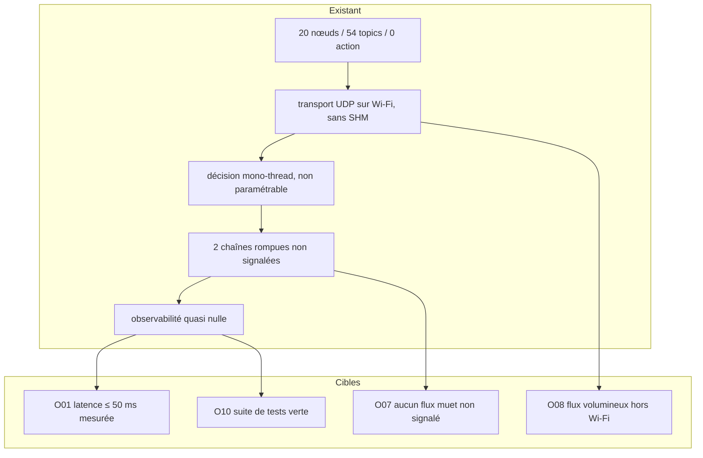

# Cahier d'entrée pour la conception d'une nouvelle architecture — Clawbot X3

> Ce document est destiné à un concepteur qui ne connaît ni le robot ni les trois autres livrables. Il tient seul : chaque chiffre porte son identifiant de source, défini dans `00_index.md`. Les renvois `voir 02 §6` désignent le fichier voisin pour le détail.

## 1. Synthèse exécutive

Le système est un robot mobile à bras (Jetson Orin NX, ROS 2 Humble, domaine DDS 28) dont la pile ROS 2 compte 20 nœuds, 54 topics, **zéro action** et **zéro nœud composable ou à cycle de vie** [S01], [S03], [S05], [S23]. Trois serveurs HTTP hors graphe (8000, 8001, 8003) portent une part de la décision et tout le pipeline de vision [S25].

- Périmètre fonctionnel observé : téléopération et sécurité du châssis, cartographie SLAM 2D, manipulation par MoveIt 2 (non active), détection d'objets, interface LLM (S1/S2) au-dessus d'un service JSON `DirectorCommand` [S04], [S38].
- La chaîne de commande existe et tient à 20 Hz : `/cmd_vel` → `safety_arbitrator` → `/cmd_vel_safe` → `driver_node` → série MCU [S08], [S02].
- Le middleware est `rmw_fastrtps_cpp` sans aucun profil chargé : tout passe par UDP sur le Wi-Fi, `/dev/shm` reste à 12 Mo sur 7,7 Go [S17], [S20], [S13], [S15].
- Les cinq nœuds maison de décision utilisent le `SingleThreadedExecutor` implicite de `rclpy.spin` et n'exposent qu'un paramètre, `use_sim_time` [S28], [S06].
- Le CPU disponible est largement suffisant (145,6 % d'un cœur sur 8, 45 % de RAM) mais le premier consommateur (57,2 %) est un nœud dont le flux principal ne produit rien [S12], [S09], [S16].
- Le test n'est pas reproductible par défaut : `scripts/run_tests.sh tests` échoue à la collecte, et la suite complète rend 238 réussites, 1 saut et 19 erreurs [S42], [S43].

### Limites structurelles

1. **Une seule voie de transport, partagée et non bornée.** Images brutes à 30 Hz et nuage de points à 10 Hz traversent la pile UDP sur Wi-Fi, sans SHM ni composition [S07], [S15], [S13].
2. **Décision séquentielle et non paramétrable.** Un thread par nœud de décision, aucune priorité, aucun réglage à chaud [S28], [S25], [S06].
3. **Deux descriptions concurrentes du démarrage.** 27 launch files d'un côté, 14 unités systemd de l'autre ; aucun n'utilise la composition ni le cycle de vie [S23], [S25].
4. **Observabilité quasi nulle.** Pas d'horodatage de bout en bout, `/diagnostics` sans consommateur, aucune mesure de latence [S30], [S07].
5. **Chaînes rompues.** Profondeur muette, détection absente du graphe, bras non commandable, et cartographie morte parce que 100 % des scans sont rejetés sur un cadre TF inexistant (`laser` vs `laser_link`) [S09], [S07], [S05], [S54].

## 2. Contraintes non négociables

| # | Contrainte | Valeur mesurée ou imposée | Marge disponible | Source |
|---|---|---|---|---|
| C01 | Carte | `NVIDIA Jetson Orin NX Engineering Reference Developer Kit Super`, 8 cœurs, 15 656 Mo, noyau `5.15.148-tegra`, Ubuntu 22.04.5 | RAM : 8,5 Go libres ; CPU : 6,5 cœurs libres (8 − 1,49 cœur consommé au repos) | [S48], [S16], [S12] |
| C02 | Distribution ROS 2 | Humble ; Jazzy n'est pas installé | aucune : tout ce qui exige Jazzy est exclu | [S17] |
| C03 | Middleware disponible | `rmw_fastrtps_cpp` ; aucun profil DDS chargé ; CycloneDDS non configuré | un profil peut être chargé, à condition de le tester hors domaine 28 | [S17], [S20] |
| C04 | Domaine DDS | 28, imposé par chaque unité systemd | aucune : changer de domaine casse 14 unités | [S25] |
| C05 | GPU | `GR3D_FREQ 0 %` : inutilisé aujourd'hui | accélérateur entièrement disponible pour l'inférence | [S16] |
| C06 | Réseau | route par défaut via `wlP1p1s0` (Wi-Fi) ; `eno1` sans porteuse ; ponts Docker `br-0ebcc2854aa2` (172.18.0.0/16) et `vethb4baedf` actifs ; `tailscale0` sans IPv4 | un lien filaire reste à câbler ; l'attribution du trafic DDS par interface n'est pas mesurée | [S49] |
| C07 | Disque | 117/147 Go occupés (84 %) ; `logrotate.service` en échec | 24 Go, dont il faut réserver la marge de build | [S13], [S34] |
| C08 | Port série du MCU | exclusif, ouvert par `Rosmaster(car_type=2)` ; deux lecteurs se volent les octets sans erreur | aucune : un seul processus propriétaire | [S25] |
| C09 | Capteurs | lidar USB 10 Hz, Astra RGB-D, caméra UVC poignet 30 Hz | cadences à ne pas dépasser sans mesure du bus USB | [S09], [S25] |
| C10 | Enveloppe du bras | pose de repos `[90, 180, 0, 0, 90, 149]` (degrés servo), bande ±5°, validée par l'opérateur le 2026-11-11 | non extensible sans nouvel essai physique | [S37] |
| C11 | Interfaces externes | service `/director/command` en JSON opaque, HTTP 8000/8001/8003 | l'appelant LLM n'est pas modifiable dans le même lot | [S38], [S25] |
| C13 | Cadre du lidar | `/scan` publie `frame_id: laser` ; l'arbre TF ne contient que `laser_link` → **40 scans rejetés en 46 s** par `slam_toolbox`, aucune carte publiée | aucune : corriger le cadre ou ajouter un TF statique, sans quoi la cartographie ne produit rien | [S55], [S54], [S10] |
| C12 | Cadences observées à respecter en régression | `/scan` 10,125 Hz, IMU 10,019 Hz, `/joint_states` 20,000 Hz, `/director/state` 4,999 Hz | une baisse de plus de 10 % est une régression | [S08], [S09] |

## 3. Interfaces à préserver

Toute refonte qui casse l'un de ces noms casse un consommateur qui n'est pas dans le lot.

| Interface | Type | Consommateur | Preuve d'existence | Source |
|---|---|---|---|---|
| `/director/command` | `clawbot_interfaces/srv/DirectorCommand` (`request_json`, `response_json`) | pont HTTP 8000, MCP, `sentinel` | service actif, schéma dans le dépôt | [S04], [S38] |
| `/director/state` | `std_msgs/msg/String` (JSON) | `sentinel`, dashboard, MCP | 4,999 Hz | [S08], [S02] |
| `/safety/state`, `/safety/hold` | `std_msgs/msg/String`, `Bool` | `director` | 20 Hz | [S08] |
| `/cmd_vel` | `geometry_msgs/msg/Twist` | `safety_arbitrator` (3 éditeurs aujourd'hui) | 3 éditeurs, 1 abonné | [S07] |
| `/cmd_vel_safe` | `geometry_msgs/msg/Twist` | `driver_node` | 20,001 Hz | [S08] |
| `/arm/servo_angles` | `std_msgs/msg/Int32MultiArray` (6 entiers) | `director`, `safety_arbitrator` | 10,016 Hz | [S08] |
| `/servo_ctrl` | `std_msgs/msg/Int32MultiArray` | `driver_node` | 1 éditeur, 1 abonné | [S07] |
| `/scan` | `sensor_msgs/msg/LaserScan`, `frame_id` `laser_link` | `slam_toolbox`, `safety_arbitrator` | 10,125 Hz | [S09], [S10] |
| `/odom`, `/vel_raw`, `/voltage`, `/imu/data_raw` | `nav_msgs`, `geometry_msgs`, `std_msgs`, `sensor_msgs` | EKF, sécurité, service matériel | 10 Hz chacune | [S08] |
| `/map`, `/map_metadata` | `nav_msgs/msg/OccupancyGrid`, `MapMetaData` (`TRANSIENT_LOCAL`) | service matériel, outils de sauvegarde | 1 éditeur, 2 abonnés | [S07] |
| TF `odom → base_footprint → base_link` | TF2, une seule racine `odom` | EKF, SLAM, MoveIt | arêtes observées | [S11] |
| TF `base_link → arm_link1..5 → {llink,rlink}`, `arm_link4 → mono_link → wrist_camera_optical_frame` | TF2 | MoveIt, caméra poignet | arêtes observées | [S10], [S11] |
| HTTP `8000` (API), `8001` (matériel), `8003` (YOLO) | REST | opérateur, LLM, MCP | unités actives | [S25] |

Contrat à ne pas oublier : **`/cmd_vel` a trois éditeurs** (`hardware_service_node`, `llm_bridge_node`, `sentinel`) et **un seul arbitre** [S07]. Toute nouvelle architecture doit trancher explicitement qui a le droit d'écrire la consigne, sinon la priorité reste implicite.

## 4. Objectifs de performance

| Objectif | Valeur cible | Justification adossée à une mesure | Mesure de vérification |
|---|---|---|---|
| O01 — Latence perception → consigne | ≤ 50 ms sur `/cmd_vel_safe` | la chaîne actuelle n'est pas mesurée (02 §1) ; 50 ms borne le temps de réaction à 15 cm à 3 m/s, au-delà du rayon d'arrêt du lidar à 10 Hz | abonné instrumenté publiant `t_sortie − t_entrée` sur `/perf/chain`, comparé sur 1 000 messages |
| O02 — Gigue de la chaîne de commande (p99) | ≤ 10 ms | mesurée à 0,63 ms sur `/safety/state` au repos (min 46 / max 53 ms), inconnue en charge [S08] | `ros2 topic hz --window 500` sur `/cmd_vel_safe`, en mission |
| O03 — Absence de blocage de l'arbitre | 0 callback dépassant 20 ms | aujourd'hui un seul thread partagé avec 50 msg/s [S28] | journal de durée par callback, publié à 1 Hz |
| O04 — CPU total de la pile ROS | ≤ 100 % d'un cœur | 145,6 % mesurés sur les 13 processus listés (149,4 % avec les trois autres), dont 57 % pour un flux muet [S12] | `ps` agrégé sur 10 min, plus `tegrastats` |
| O05 — RAM de la pile ROS | ≤ 1,5 Go hors inférence | 700 Mo hors `yolo_service` aujourd'hui [S12] | RSS cumulé par `ps`, sur 10 min |
| O06 — Inférence sur GPU | `GR3D_FREQ > 0 %` en inférence | GPU à 0 % pendant que YOLO consomme 10 % de CPU [S16] | `tegrastats` pendant 100 inférences, `GR3D_FREQ` moyen |
| O07 — Aucun flux capteur muet non signalé | 100 % des flux attendus déclarés et surveillés | 2 flux muets non signalés aujourd'hui [S09], [S07] | test qui coupe un flux et vérifie l'apparition d'un état `SENSOR_STALE` |
| O08 — Transport des flux volumineux | images et nuages hors du chemin Wi-Fi | images brutes 30 Hz sur UDP/Wi-Fi [S07], [S15] | `ss -uan` + compteurs d'interface pendant une mission ; `/dev/shm` doit cesser d'être à 12 Mo |
| O09 — Démarrage à froid | ≤ 30 s jusqu'à `/safety/state` valide | non mesuré : `[NON OBSERVÉ / À VÉRIFIER]` → obtenir : `systemd-analyze` puis chronométrage du premier message | chronométrage du premier `/safety/state` après `systemctl start` |
| O10 — Suite de tests exploitable | 0 erreur de collecte, ≥ 95 % de réussite | 2 erreurs de collecte, 19 erreurs, 238 réussites [S42], [S43] | `scripts/run_tests.sh tests` sort 0 et affiche le total |
| O11 — Simplicité opérationnelle | ≤ 1 description du démarrage, ≤ 15 nœuds | 2 descriptions (27 launch + 14 unités), 20 nœuds [S23], [S25], [S01] | inventaire du dépôt : un seul point d'entrée, plus aucun lancement `ros2 run` dans une unité |

## 5. Questions ouvertes

| ID | Question | Pourquoi elle bloque la conception | Comment la trancher | Bloquante ? |
|---|---|---|---|---|
| Q01 | La profondeur Astra est-elle réparable (USB 2 vs 3, mode vidéo, `depth_fps`) ou faut-il la retirer ? | elle détermine si `sentinel` garde une entrée de profondeur et si 57 % de CPU sont récupérables | mesurer en domaine 99 avec `depth_fps` réduit, puis `ros2 topic hz /camera/depth/image_raw` | oui |
| Q02 | Quel est le débit réel du lien USB entre Astra, YDLidar et la caméra du poignet ? | conditionne les cadences cibles (O01, O08) | `lsusb -t` (arborescence et vitesse par port) et compteurs `usbmon` sur 60 s | oui |
| Q03 | L'inférence doit-elle rester hors graphe (HTTP) ou redevenir un nœud ROS 2 ? | change le contrat d'interface et la mesure de latence | décision d'architecture ; la mesure qui l'éclaire est le temps de réponse de `POST /detect` (O06) | oui |
| Q04 | Peut-on câbler `eno1` (Ethernet) pour sortir les flux du Wi-Fi ? | conditionne O08 et la stabilité de la découverte DDS | `ip -s link show eno1` avec un câble, puis test de découverte en domaine 99 | oui |
| Q05 | Le mode `mapping` de SLAM doit-il rester actif en permanence ? | un écrivain permanent de `map → odom` interdit Nav2 simultané (`Conflicts=`) | décision produit + mesure CPU de `slam_toolbox` (2,2 % au repos) | non |
| Q06 | Quelle est la politique d'écriture de `/cmd_vel` (arbitrage à 3 éditeurs) ? | toute refonte doit la nommer, sinon la priorité reste implicite | relevé des intentions dans le code des 3 éditeurs + décision | oui |
| Q07 | La composition (`ComposableNode` + intra-processus) est-elle viable avec les binaires vendor (astra, ydlidar, robot_localization) ? | elle décide du gain de transport et de la faisabilité de O08 | prototype en domaine 99 avec les trois binaires vendor en conteneur composable | oui |
| Q08 | Quel budget thermique en charge continue ? | 53 °C au repos ne dit rien d'une mission de 20 min | `tegrastats --interval 1000` pendant une mission réelle, robot au sol, opérateur présent | oui |
| Q09 | Les 5 messages `yahboomcar_msgs` sont-ils morts ? | ils n'ont aucun éditeur ni abonné mais occupent le contrat d'interface | `grep` de chaque type dans tout l'arbre déployé, vendor compris | non |
| Q09b | Faut-il corriger `frame_id` côté lidar (`laser_link`) ou publier un TF statique `laser → laser_link` ? | le choix touche un fichier vendor et le paramètre `frame_id` du driver ; il décide si `slam_toolbox` fonctionne | appliquer les deux variantes en domaine 99 et comparer `/map` produit et `ros2 run tf2_tools echo laser laser_link` | oui |
| Q10 | Le port série du MCU doit-il être exposé en paramètre (`device_path`) ? | il est aujourd'hui auto-détecté, donc non maîtrisable ni testable | décision ; la mesure de soutien est `ls -l /dev/serial/by-id/` et la stabilité de l'énumération au rebranchement | non |
| Q11 | Faut-il conserver `rosbridge` (WebSocket) exposé sur le réseau ? | il ajoute une surface d'attaque et 9,9 % de CPU | `ss -ltnp` pour le port, puis décision de sécurité | non |
| Q12 | Le service `clawbot-docs` doit-il rester un serveur de développement sur `0.0.0.0:8080` ? | exposition réseau sans authentification | décision d'exploitation ; remplacer par un site statique si la réponse est non | non |
| Q13 | Quel est le contrat exact du JSON de `DirectorCommand` ? | interface opaque : aucun schéma, aucune validation à la frontière | extraire les `op` acceptés du code du directeur et les publier comme schéma (JSON Schema) | oui |
| Q14 | Le robot peut-il être immobilisé 30 min pour mesurer le MCU (firmware, latence série) ? | deux SPOF ne sont mesurables que pilote arrêté | accord opérateur + protocole : arrêt de `ros2-driver-node`, lecture `Rosmaster_Lib`, redémarrage, vérification `/voltage` à 10 Hz | oui |

## 6. Limites du dossier

- **Mesuré** le 2026-11-22 entre 10:59 et 11:25 (CET), **robot au repos**, aucune consigne de mouvement envoyée. Toutes les cadences et consommations décrivent ce régime ; elles constituent un plancher, pas un profil de mission.
- **Non mesuré** : latence bout-en-bout, pertes de messages, ventilation CPU par callback, comportement sous charge, thermique en mission, débit USB, identité USB des capteurs, firmware du MCU. Chaque manque porte sa recette dans `00_index.md` §4 et dans les sections 7 des livrables 01 et 02.
- **Consigne au concepteur :** les mentions `[NON OBSERVÉ / À VÉRIFIER]` ne sont **pas des zéros**. Ne les traitez pas comme « pas d'impact » : ce sont les zones où l'architecture actuelle est muette, donc celles où une refonte doit d'abord instrumenter avant de promettre.

