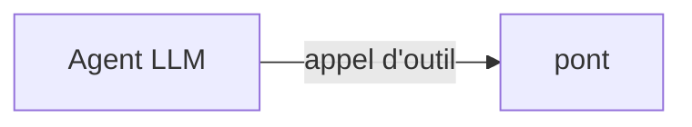

# Poste de documentation

Cette page décrit l'organisation de la documentation du Clawbot X3 : d'où viennent les pages, comment
elles sont rendues, comment les modifier et comment le site est publié sur le port 8080.

## 1. Objectif et principes

| Principe | Mise en œuvre |
|---|---|
| Une seule source de vérité par document | La base de connaissances vit dans le dépôt (`docs/knowledge-base/`) ; `/Robot_Knowledge_Base` est un lien symbolique vers ce dossier |
| Aucune conversion manuelle | Les sources restent du Markdown avec en-tête OKF et liens `[[...]]` ; le rendu est fait par un hook |
| Rendu hors ligne | La bibliothèque Mermaid est embarquée dans le dépôt, aucun CDN n'est requis |
| Traçabilité | Chaque page porte `date`, `author`, `tags`, `status` ; les mesures portent leur source |
| Publication continue | Le service systemd reconstruit le site à chaque modification de fichier |

## 2. Arborescence du dépôt

```
clawbot/
├── mkdocs.yml                     # configuration du site (thème, extensions, navigation)
├── hooks/
│   └── wikilinks.py               # conversion [[lien]] -> lien Markdown + bandeau OKF
├── services/
│   └── clawbot-docs.service       # unité systemd de publication (port 8080)
├── docs/
│   ├── index.md                   # accueil du site
│   ├── site-documentation.md      # cette page
│   ├── knowledge-base/            # base de connaissances OKF (source unique)
│   │   ├── index.md
│   │   ├── 01_Hardware/           # 4 pages matériel
│   │   ├── 02_Software/           # 8 pages logiciel, dont 4 sur le pont LLM
│   │   └── 03_Operations/         # journal + 4 traces d'erreurs
│   ├── api/                       # référence API générée par mkdocstrings (15 pages)
│   ├── legacy/                    # documentation historique du dépôt
│   │   ├── index-old.md
│   │   ├── knowledge.md
│   │   └── build_and_update.md
│   └── assets/
│       ├── logo.svg
│       ├── stylesheets/okf.css
│       └── javascripts/
│           ├── mermaid.min.js     # Mermaid 10.9.1, embarqué
│           └── mermaid-init.js    # initialisation et rendu à chaque navigation
└── site/                          # sortie de build (généré, non versionné)
```

## 3. Fusion des sources

Trois corpus cohabitaient avant cette réorganisation.

| Corpus d'origine | Emplacement d'origine | Destination | Traitement |
|---|---|---|---|
| Base de connaissances OKF | `/Robot_Knowledge_Base` (18 fichiers) | `docs/knowledge-base/` | Déplacée dans le dépôt, lien symbolique conservé à la racine |
| Documentation du pont | `ros2_llm_bridge/docs/`, `README.md`, `PRD.md`, `nervous_system.md` | `docs/legacy/` et pages OKF du pont | Conservée pour mémoire ; les écarts sont documentés dans la page de cohérence |
| Référence API | `docs/api/`, `docs/knowledge.md`, `docs/build_and_update.md` | `docs/api/` et `docs/legacy/` | Conservée, réintégrée dans la navigation |

Le point d'entrée `/Robot_Knowledge_Base` reste valide :

```bash
$ ls -ld /Robot_Knowledge_Base
lrwxrwxrwx 1 root root 40  /Robot_Knowledge_Base -> /home/jetson/clawbot/docs/knowledge-base
```

Conséquence : éditer une page depuis `/Robot_Knowledge_Base` ou depuis `docs/knowledge-base/` modifie
le même fichier, versionné par Git.

## 4. Rendu des pages

### 4.1 En-tête OKF et bandeau

Chaque document de la base commence par un frontmatter YAML :

```yaml
---
title: "llm2ros bridge — état constaté du service LLM → ROS 2"
date: "2026-11-10T06:22:20+08:00"
author: "Hermes Agent"
tags: [software, llm, ros2, api, bridge, architecture, constat]
status: validé
---
```

MkDocs lit ce bloc via l'extension `meta` et ne l'affiche pas tel quel. Le hook `wikilinks.py` le
réinjecte sous le titre sous forme de bandeau : `status` en pastille colorée (vert `actif`, bleu
`validé`, rouge `ouvert`, gris `obsolète`), date de mise à jour et étiquettes.

### 4.2 Liens wiki `[[...]]`

Les documents utilisent la syntaxe Obsidian `[[nom_du_fichier]]`, valide pour le validateur OKF mais
inconnue de MkDocs. Le hook `hooks/wikilinks.py` la convertit à la volée :

| Cas | Traitement |
|---|---|
| `[[ros2_nav_stack]]` | Résolution par nom de fichier, lien relatif calculé depuis la page courante |
| `[[nom\|libellé]]` | Le libellé remplace le nom du fichier |
| Nom ambigu (`index`) | Choix du fichier le plus proche dans l'arborescence (même dossier, puis parent) |
| Cible introuvable | Lien laissé tel quel, visible en clair dans la page |

Aucun fichier source n'est modifié : la base reste utilisable telle quelle dans Obsidian.

### 4.3 Diagrammes Mermaid

Les diagrammes sont des blocs de code balisés `mermaid` :

````markdown

````

Le rendu est assuré par `pymdownx.superfences` (fence personnalisée de classe `mermaid`) et par
`mermaid-init.js`, qui relance le rendu à chaque navigation instantanée de Material. La bibliothèque
`mermaid.min.js` (10.9.1) est versionnée dans `docs/assets/javascripts/` : le site fonctionne sans
accès Internet.

### 4.4 Pages Skills (générées)

Le menu **Skills** publie l'inventaire réel des skills de l'agent, sans saisie manuelle :

```bash
python3 scripts/generate_skills_docs.py     # HERMES_HOME par défaut : ~/.hermes
sudo systemctl restart clawbot-docs.service
```

| Point | Règle appliquée |
|---|---|
| Sources | `~/.hermes/skills/<catégorie>/<nom>/SKILL.md` et `~/.hermes/plugins/<plugin>/skills/<nom>/SKILL.md` |
| Nom affiché | `name` du frontmatter ; les skills de plugin sont préfixés `<plugin>:` |
| Description | `description` du frontmatter, tronquée à 150 caractères dans le tableau |
| Entrées liées | Compte des fichiers dans `references/` et `scripts/` du skill |
| Dossiers ignorés | Tout chemin contenant un segment commençant par `.` (archives, sauvegardes) |
| Navigation | Le script réécrit le bloc encadré par `# skills-nav:start` / `# skills-nav:end` dans `mkdocs.yml` |
| Pages produites | `docs/skills/index.md` (vue d'ensemble) + un fichier par catégorie |

Les pages générées portent `generated: true` dans leur frontmatter ; elles sont réécrites à chaque
exécution et ne doivent pas être éditées à la main.

## 5. Publication sur le port 8080

| Élément | Valeur |
|---|---|
| Unité systemd | `clawbot-docs.service` |
| Commande | `mkdocs serve --dev-addr 0.0.0.0:8080` depuis `/home/jetson/clawbot` |
| Rechargement | Automatique à chaque modification d'un fichier de `docs/` ou de `mkdocs.yml` |
| Adresse | `http://<ip-du-robot>:8080` |
| Copie versionnée de l'unité | `services/clawbot-docs.service` |

Commandes d'exploitation :

```bash
# état et journaux
systemctl status clawbot-docs.service
journalctl -u clawbot-docs.service -n 50 --no-pager

# redémarrage après modification de mkdocs.yml
sudo systemctl restart clawbot-docs.service

# vérification de la réponse HTTP
curl -s -o /dev/null -w '%{http_code}\n' http://localhost:8080/

# build statique (publication sans serveur de développement)
mkdocs build --clean
```

Le mode `mkdocs serve` reconstruit le site en mémoire et sert le résultat ; il ne produit pas de
fichiers dans `site/`. Pour une publication statique, exécuter `mkdocs build` puis servir `site/`.

## 6. Mode d'emploi d'édition

1. Écrire ou modifier la page dans `/Robot_Knowledge_Base/` (ou `docs/knowledge-base/`, chemin
   équivalent), avec son en-tête OKF et ses liens `[[...]]`.
2. Valider la conformité de la base :

```bash
python3 /home/jetson/.hermes/skills/robotics/robot-knowledge-base/scripts/validate_okf.py
```

Sortie attendue : `OKF conforme : N fichier(s), 0 erreur.` Le script contrôle les cinq clés,
le format ISO 8601 de `date`, `author`, `tags`, `status` et la résolution de tous les liens.

3. Valider la syntaxe Mermaid si la page contient des diagrammes (voir §7).
4. Recharger la page dans le navigateur : `mkdocs serve` a déjà reconstruit le site.
5. Ajouter la page à la navigation `mkdocs.yml` si elle est nouvelle, puis redémarrer le service.
6. Versionner : `git add docs mkdocs.yml hooks services && git commit -m "docs: ..."`.

## 7. Validation des diagrammes

Le contrôle de syntaxe s'exécute hors ligne avec le parseur Mermaid officiel :

```bash
mkdir -p /tmp/mmd && cd /tmp/mmd
npm init -y && npm i mermaid jsdom
node /home/jetson/.hermes/skills/robotics/robot-knowledge-base/scripts/check_mermaid.mjs \
     /Robot_Knowledge_Base/02_Software/*.md
```

Sortie attendue : `Bilan : N bloc(s), 0 erreur(s) de syntaxe.` Le répertoire `node_modules` pèse
environ 230 Mo et doit être supprimé après usage : la partition racine dispose de 4,2 Go libres.

## 8. Organisation de la navigation

| Section | Contenu | Source |
|---|---|---|
| Accueil | Synthèse du robot, état au 2026-11-10, anomalies ouvertes | `docs/index.md` |
| Poste de documentation | Cette page | `docs/site-documentation.md` |
| Base de connaissances | 19 pages OKF, groupées Matériel / Logiciel / Opérations | `docs/knowledge-base/` |
| Référence API | 15 pages extraites des docstrings Python | `docs/api/` |
| Skills | Inventaire des 98 skills de l'agent : vue d'ensemble + une page par catégorie | `docs/skills/`, généré par `scripts/generate_skills_docs.py` |
| Héritage | Ancienne page d'accueil, notes d'exploitation, guide de build | `docs/legacy/` |

## 9. Dépannage

| Symptôme | Cause | Remède |
|---|---|---|
| Page 404 sur une section | Page absente de `nav` | Ajouter l'entrée dans `mkdocs.yml`, redémarrer le service |
| Lien `[[...]]` affiché en clair | Nom de fichier introuvable ou ambigu | Vérifier le nom exact du fichier cible |
| Diagramme en bloc de code | `mermaid.min.js` ou `mermaid-init.js` absent | Vérifier la présence des deux fichiers dans `docs/assets/javascripts/` |
| Avertissement `mkdocstrings` | Module non importable depuis l'environnement de build | Sourcer l'environnement ROS 2 avant le build, ou retirer la page de `nav` |
| Port 8080 occupé | Ancien processus `mkdocs serve` | `ss -ltnp \| grep 8080`, puis arrêter le processus |

## 10. Historique de cette réorganisation

| Élément | Valeur |
|---|---|
| Branche | `docs/site-okf-merge` |
| Base | `main` du dépôt `morgoth31/clawbot` |
| Contenu ajouté | `mkdocs.yml` réécrit, `hooks/wikilinks.py`, `docs/knowledge-base/` (18 pages), `docs/index.md`, cette page, `docs/assets/`, `services/clawbot-docs.service` |
| Contenu déplacé | `docs/index.md` → `docs/legacy/index-old.md`, `docs/knowledge.md` → `docs/legacy/knowledge.md`, `docs/build_and_update.md` → `docs/legacy/build_and_update.md` |
| Liens wiki | Résolus à la compilation ; aucune modification des sources OKF |

## Voir aussi

- [Accueil du site](index.md)
- [Vue d'ensemble de la base de connaissances](knowledge-base/index.md)
- [Conventions d'écriture OKF](knowledge-base/index.md#3-conventions-decriture)
